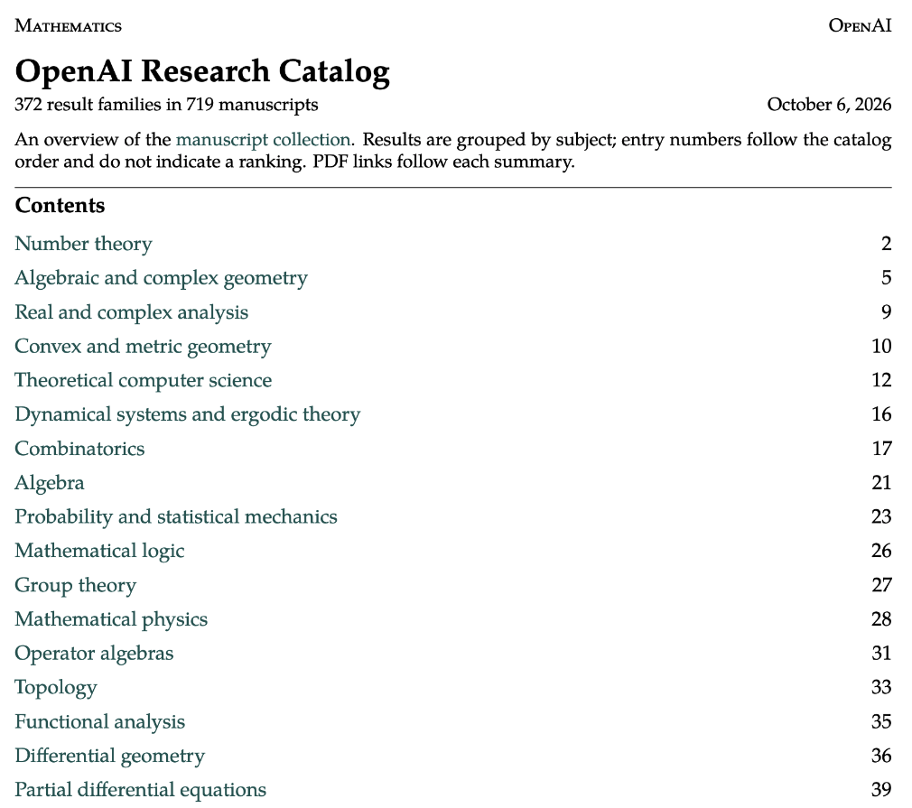

Title: Maxing周刊 EP11 2026w41: 投资&去魅
Date: 2026-10-11
Category: misc
Tags: weekly
Slug: maxing-weekly-ep11-2026w41

## news / 新闻
- [OpenAI 722篇数学论文洗地](https://mp.weixin.qq.com/s/wIRGlRIPTIa3C6NSi9CAKA)
  - arxiv有论文数的限流器, 所以直接发到了github:  https://github.com/openai/math
  - 离谱的是 平均每个成果消耗的算力大约相当于*3小时的ChatGPT Pro*... 

- [Claude Haiku5.5发布](https://mp.weixin.qq.com/s/bF9veA0qzJ7L2WbrWWDdcg)
  - 之前haiku版本停在4.5已经好久了 以为Anthropic已经放弃这条先了呢
  - 这次斩杀了上次斩杀一众国产模型的GPT6-Luna?
  - 最近感觉: 模型并不是一个好生意? 用户基本上没有什么忠诚度可言, 今天梁圣明天梁子, 所有prompts/artifacts/skills都在本地, 完全就是谁家效果好/性价比高就换谁... **AI is becoming a commodity.**
- 尊界V800连测三台车 刹车踏板断裂
  - 还是不要神话任何企业和企业家
  - 想起了之前风评两极反转的布鞋首富宗庆后

**谷歌动态**:
- [EmbeddingGemma2](https://blog.google/innovation-and-ai/technology/developers-tools/embeddinggemma-2/):
  - 多模态的向量embedding模型, 目前的SOTA水平.
  - 有点意思的是它做成了可拆卸的结构, 纯文本的参数上可以选装视觉和音频的理解能力
- [谷歌上线GenAI游戏平台](https://mp.weixin.qq.com/s/KbhHB4huDPVbwX-R0O1lpQ) http://playground.google.com/
  - 标题党说"谷歌一夜之间把游戏开发的饭碗砸了", 但我记得上一次谷歌宣布进军游戏界 搞的平台叫stadia...
- [Gemini Agent 开始接入claude](https://cloud.google.com/blog/products/ai-machine-learning/welcome-to-gemini-at-work-2026)
  - 所以这个Gemini Agent和之前的Gemini Spark有什么不同? 搞不懂🐶家的操作
  - 另外Grok Bot也接入opus5.5了, 看来opus5.5确实是目前来说综合agent能力最强的模型, 希望开源各家能快点跟上
- [Google AI Edge Foresight](https://developers.google.com/edge/foresight) -- 谷歌发布的**离线**AI工作台, 可以记录转写会议 或者总结/润色/提问/etc.
  - 我记得之前还出过[AI Edge Eloquent App](https://developers.google.com/edge/eloquent) 主打隐私友好纯本地的语音笔记, 但试了一下至少中文效果比较拉胯
  - 但确实未来侧端的本地AI大有可为, 目前本地小模型的能力还差点意思

**近期AI抽象梗**：
- "不烧心"
- "闪身步"
- "xx环球演唱会"

## gems / 分享

**博客**: [知行小酒馆 E251 对话方言：你相信的是价值投资，还是巴菲特的造富神话？](https://www.xiaoyuzhoufm.com/episode/6aa37bcd492687f6aad83995)
- 最大的takeaway是 所有价值投资者都不是从零开始*只靠投资*成为富豪的, 首先需要积累. 所有价值投资都是挣着钱以后选择了*过价值投资的日子*.
- 另外对有钱人的生活部分去魅了 世俗意义上的成功并不意味着身心的富足充实; 也对许多的创业神话部分去魅了 商业更多时候还是尔虞我诈的斗兽场
- > 如果你这笔消费没有人看得到，你还愿不愿意消费？
- > 你不自己做一家公司、被客户伤害、被手下人折腾，你无法看懂一家公司
- >  建立自己的独立思维，因为机会有的是。芒格、段永平也不是每个机会都抓住。**不要把别人赚的钱当做自己亏的钱**，你抓住你的机会就行了。
- > **让你不舒服的观点, 试着对它保持一点好奇**
- > 在投资之前：第一，我拿来投资的真的是一笔可以耐心等待的钱吗？第二，如果市场几年都没有给我期待中的回报，我的生活还能不能继续？第三，当我说我自己看懂了一家公司的时候，我究竟看懂了什么？ 可以先放下那个必须通过投资证明自己的想法，把当下真正能够做好的事情一一做好。

**读书**: [会走路的钱: 普通人家十年一千万理财实录](https://book.douban.com/series/73712)
  - > 以纪实方式记录了1997年到美国后白手起家从200美金到1000万美金的资本积累过程，包含投资计划的每一步细节，对市场趋势的判断，及每一笔交易的细节与心态路程和失败的经验教训
  - 之前Google内部还邀请作者贝版来做分享 我也是那时看到邮件听说了这本书 顺便下载了一下电子书 然后一直没看 也没去看那次分享的recording, 最近想看当时的recording 发现已经过期了...
  - 目前只读到了他在美国和上海同时买房那一段, 感觉作者有着中国人的勤劳, 踏实, 节俭, 善于思考等优秀品质. 同时还有着很强的决策力&行动力, 在911和SARS的恐慌节点, 依然在中美买房.
  - 书中的坦诚也让我印象深刻, 他会写自己跟风盲目买股票的赌徒心态, 亏钱以后的绝望. 
  - 他的很多见解不只对于投资, 对生活也很受用. 比如他观察到, 很多顶尖聪明的人, 总是会找到千万个理由去支持自己的决策(或者支持自己"暂时观望"). 
  - 感觉投资这件事情真的很难. 忘了是谁说的了, **你性格里的缺点/弱点, 会在交易市场上被无限放大**.

**网站分享**: 电子书下载平台 -- 之前的zlibrary 被FBI封了以后, 直接搞了个网站: https://fuckfbi.ru/ 😂

## misc / 杂记

### 运动
- 周二半小时核心, 结束之后引体6个, 然后再吊单杠 只坚持了52秒
- 周三力量 泽奇深蹲40kg 8reps x 3
- 周四瑜伽 -- 开始前吊杠86秒, 瑜伽课结束后引体5个(拉到感觉动作要变形就停)

### 周末带娃
这周天气不好 得找室内的场地
- [Ebianum Baggermuseum](https://www.ebianum.ch/): 瑞德边境的挖掘机博物馆, 好多退役挖掘机可以爬上去玩 还有室内bobby car和沙坑给娃放电
- [苏黎世大学自然历史博物馆](https://www.nmz.uzh.ch/en.html): 周日也免费开放 超多硬核标本展品 苏黎世带娃必去