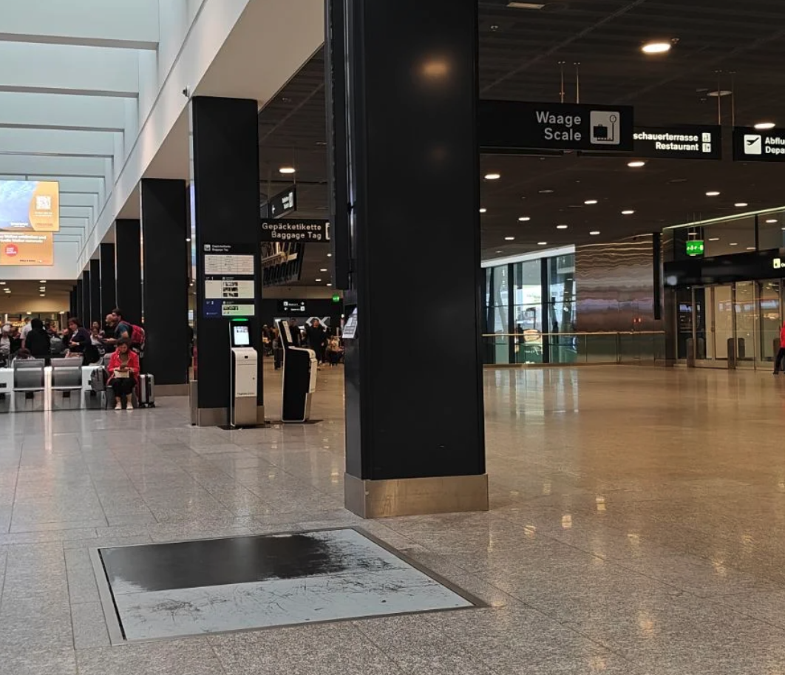
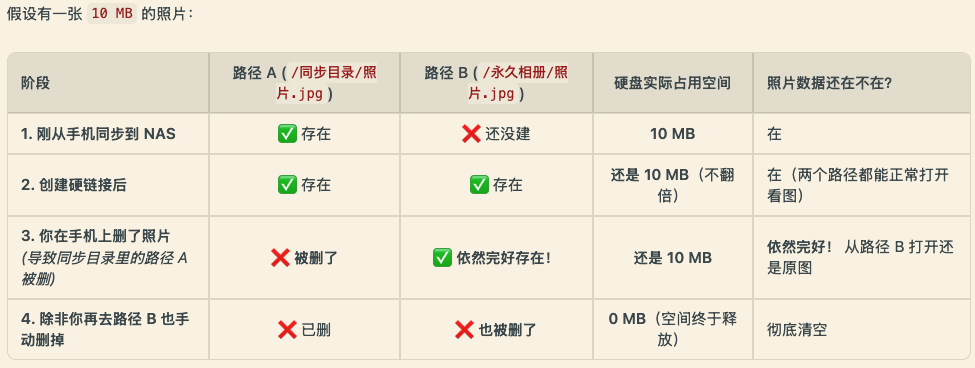
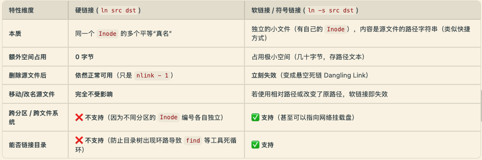

Title: Maxing周刊 EP12 2026w42: 硬链接的妙用
Date: 2026-10-18
Category: misc
Tags: weekly
Slug: maxing-weekly-ep12-2026w42

## news / 新闻

### AI 新闻
- [REA skill-- 可以逆向任何软件](https://mp.weixin.qq.com/s/j99L5qfSPSMB9L8-25Qjdg)
- [MiniCPM-V 4.7发布](https://mp.weixin.qq.com/s/j99L5qfSPSMB9L8-25Qjdg)
  - 3G内存可以跑35B-A3B的多模态MOE?
  - 还有一个更小的1B模型 也达到了帕累托最优
  - MiniCPM这家基本都是专注侧端AI 之前的MiniCPM5-2B模型是我本地处理敏感文件的主力
- Muse Spark Open发布
  - 号称是*美国*最强开源模型 (可以 那很谦虚了)
- DeepSeek4.1-flash 新版发布, 新的帕累托前沿?
- 特斯拉发布会飞的汽车 -- 感觉更多是噱头&博眼球?
- [character.ai破产, 0.1折贱卖给迪士尼](https://mp.weixin.qq.com/s/RyiBl790wVmAXp0bhT2riQ) 
- [anthropic评级BB+](https://mp.weixin.qq.com/s/Nd1x2w-gXVRRHP5_TIzMxQ)
- deno被cloudflare收购 六个月后结束支持...

## gems / 分享

### 好物分享: 带横滚轮的鼠标
我买的是[飞利浦MX Prime4](https://3.cn/37-MVGfB?jkl=@V95tYDh3za@), 用了几个月了体验很不错.
- 最大卖点就是带一个横向滚轮, 在大拇指位置, 用来看比较宽的表格/代码非常方便
- 另大拇指附近也有前进/后退的快捷键 浏览器里比较常用
- 其他的feature包括: 自带按钮可以调节鼠标灵敏度 / typeC充电口

### antigravity - 使用chrome MCP, 更快的浏览器控制
之前用`/browser`控制浏览器, 虽然可以完成任务, 但痛点是:
1. 每次需要点同意远程debug
2. 直接在主浏览器里面 接管你来控制
3. 速度很慢, 每次点击操作都要截图发给模型 思考后进行下一步动作 比如点击页面的XY坐标
  (当然这样做的好处是最后会给你一个操作录屏, 但大多数时候其实用不到)

==> 更优化的版本是使用`Chrome DevTools MCP`

- 100% 隔离的专用chrome profile: 使用独立持久化目录的专用 Chrome 窗口, 零授权弹窗, 不碰主浏览器.
  - 而且也可以手动打开这个profile, 在这里登录各种网站账号一次 即可永久保存
  - 添加`--autoConnect`就可以切换成让MCP操作主浏览器
- 直接秒读DOM树, 或者注入js直接批量操作, 速度远快于`/browser`

我的配置如下:

```json
$ cat ~/.gemini/config/mcp_config.json
{
  "mcpServers": {
    // 通道 A（默认主力）：独立专用 Chrome 窗口
    // 使用独立 Profile (~/.cache/chrome-devtools-mcp/chrome-profile)，与主浏览器完全隔离，免弹窗
    "chrome-devtools-mcp": {
      // 建议使用 npx 的绝对路径，防止 macOS GUI 应用子进程找不到命令
      "command": "$HOME/.local/bin/npx",
      "args": [
        "-y",
        "chrome-devtools-mcp@latest",
        // 【关键避坑 1】移除 Puppeteer 默认的 --enable-automation 标志，消除顶部“正受到自动测试软件控制”横幅
        "--ignoreDefaultChromeArg=--enable-automation",
        // 【关键避坑 2】关闭 Blink 自动化受控特征（使 navigator.webdriver 变为 false）
        // 缺少这两项会导致在独立窗口登录 Google 账号时报错“无法登录：此浏览器或应用可能不安全”
        "--chromeArg=--disable-blink-features=AutomationControlled"
      ],
      "env": {
        // 【关键避坑 3】显式注入 node/npx 所在 PATH，解决 macOS Electron 宿主环境变量残缺问题
        "PATH": "$HOME/.local/bin:/opt/homebrew/bin:/usr/local/bin:/usr/bin:/bin"
      }
    },

    // 通道 B（按需备用）：连接日常正在运行的主 Chrome
    // 平时懒加载不启动；仅在自然语言明确要求“看主浏览器”或使用 @chrome-main 时触发
    "chrome-main": {
      "command": "$HOME/.local/bin/npx",
      "args": [
        "-y",
        "chrome-devtools-mcp@latest",
        // 开启自动连接主 Chrome（需在主浏览器 chrome://inspect/#remote-debugging 勾选允许远程调试）
        "--autoConnect"
      ],
      "env": {
        "PATH": "$HOME/.local/bin:/opt/homebrew/bin:/usr/local/bin:/usr/bin:/bin"
      }
    }
  }
}
```

## misc / 杂记

### 运动
本周没有瑜伽课 只有两次力量 感觉身体有点僵硬...
- 周三硬拉 8reps : 65kg-85kg-90kg-90kg
  - finisher test: 5个引体

### 周末带娃
[苏黎世机场露天观景平台](https://www.myswitzerland.com/zh-hans/experiences/observation-deck-at-zurich-airport/)
- 位置就在登机口旁边五十米左右, 按照牌子找`Zuschauerterrassen/Observation Deck`就可以
- 可以观看飞机起降, 还有一些小孩玩的地方
- 凭登机牌可以免费进入 -- 以前都不知道有这回事
- 成人票5块, 另外每月15号都是免费进入
- 还在机场发现了有用于称行李的区域(也可以站上去称体重)



### 硬链接的妙用

这周和antigravity讨论我现在手机照片备份, 有一个场景的痛点是: 手机的照片通过syncthing备份到NAS以后, 如果手机删除照片, syncthing也会把NAS里的文件也删掉, 之前要么先修改手机端的stignore再删照片, 要么NAS里设置忽略删除, 都不是很方便.

AI提供了一个很简洁的解决方案: 

> 在NAS上设置"同步中转目录"与"永久归档目录", 用cron脚本把中转目录的内容**硬链接**到永久归档目录里

关键就是这个"硬链接", 它的效果是两个文件指向同一份数据块, 所以占用存储空间不变, 但是删除一个文件并不会连带删除另一个! 



#### 硬链接背景知识
我之前从来都是用软链接`ln -s`, 也就不知道硬链接是干啥的, 问了一下Gemini大概理解了, 这里总结一下其中的背景知识.

**现代文件系统里的两种链接**
- 硬链接("Hard" Link, `ln`): 两个路径直接指向同一个底层数据块(**inode**), 平起平坐, 只占一份空间; 删掉其中一个路径, 另一个路径的数据依然完好存在(只有所有硬链接路径全被删光, 空间才会释放).
- 软链接 / 符号链接(Symlink, `ln -s`): 相当于快捷方式, 只记录原路径文本; 一旦原路径文件被删, 软链接就会失效变成死链.

**`inode`是什么**
在Linux文件系统中, *文件名/路径* 和 *文件内容* 是解耦的:
- 文件名: 只是存放在目录项(directory entry)里的普通字符串, 本质是一张映射表: *文件名 -> inode 编号*.
- 文件实体(`inode`): 全称 Index Node(索引节点), 它是文件的元数据载体(文件权限/所有者/大小/时间戳, 以及最重要的**硬链接计数 Link Count**). inode 本身不存储文件名, 也不存储文件路径
  - 删除一个hard link, 只不过把硬链接计数减1, 只有当硬链接计数=0的时候, 空间才真正释放

**硬链接的限制**
1. 不能跨文件分区使用
2. 不能作用于目录
3. 很多编辑器(如vim)在修改保存文件时, 并不是直接在原文件上写入, 而是"先写临时文件 -> 删除原文件名 -> 把临时文件重命名覆盖" ==> 这种保存方式会给当前文件名分配一个全新的 inode, 从而导致硬链接被意外打断.



**硬链接的其他应用场景**
1. PT 保种与媒体库刮削分离: 下载目录保持原始种子文件名用于保种, 同时通过硬链接在 Jellyfin/Plex 媒体库目录中按规范重命名刮削, 一份体积双处使用. 
  -- 这个我(交大葡萄资深老用户)也用得上!
2. rsync增量快照备份: 这个还蛮有意思的, 比如一个经常变动的目录, 用`rsync --link-dest`, 只需要用很小的空间, 就可以备份这个目录在不同时刻的**全量**内容, 方便回滚. 

```sh
# Day 1 (全量备份)
rsync -a /data/ /backup/day-1/
# Day 2 (增量快照)
rsync -a --link-dest=/backup/day-1/ /data/ /backup/day-2/
# => 结构上: 每一天的目录(day-1, day-2, day-3)看起来都是一个完整独立的全量备份, 可以直接进去浏览/恢复, 无需复杂的回滚合成.
# => 存储上: 只有发生改动的文件才消耗新磁盘空间, 未改动的文件仅消耗一个目录项的元数据, 几乎零额外存储开销.
# => 删掉 day-1 目录, 仅仅是对应文件的 inode 引用计数减 1, 不会破坏 day-2 的可用性.
```