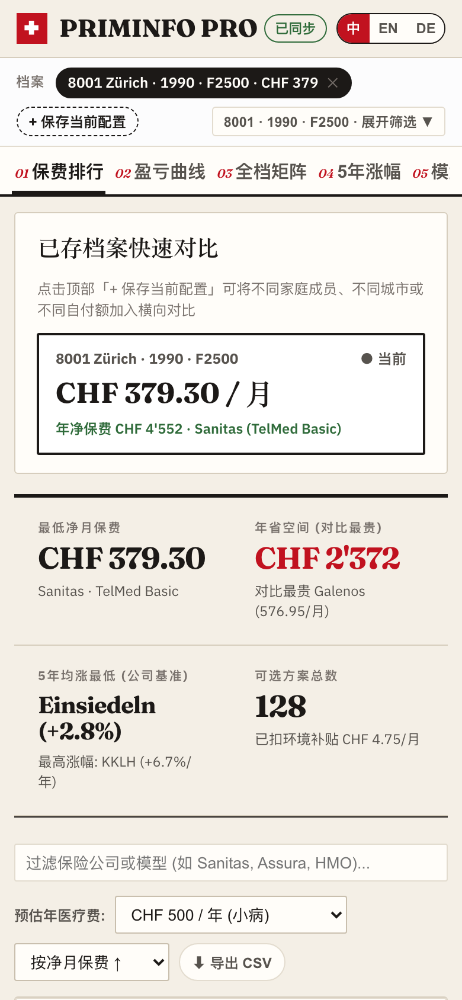

Title: Maxing周刊 EP13 2026w43: 龙虾之后, 人人都是龙虾
Date: 2026-10-25
Category: misc
Tags: weekly
Slug: maxing-weekly-ep13-2026w43

## news / 新闻
- [DeepSeek开源了推理框架](https://mp.weixin.qq.com/s/VEO_ASilKrglscq3fGExng)
  - 这才是真正的OpenAI!
  - 他们还公布了单卡营收(38美元/小时), 外界估算毛利率>80%
- [Kimi K3.1 发布](https://mp.weixin.qq.com/s/Q6Z-skAUH_na9g37VWbHew)
  - 看评分继续领跑开源SOTA, 和Opus/Astra打得有来有回
  - 不管宣传是否有水分, 之前Cursor还有Devin都是基于Kimi的模型后训练, 说明Kimi已经是最强开源基座了
- 欧盟放弃光伏和AI? 
  - [欧盟取消对中国光伏玻璃反倾销关税](https://www.guancha.cn/GuoJi%C2%B7ZhanLue/2026_10_23_905478.shtml) 
    - >随着本土生产商悉数停产，欧盟也失去了继续以保护本土产业为由延长相关关税的现实基础。
  - [欧盟主席准备放弃前沿AI追赶中美](https://www.guancha.cn/GuoJi%C2%B7ZhanLue/2026_10_24_905596.shtml)
- [长征六号水母形状火箭云](https://mp.weixin.qq.com/s/UxyBx9VV6wAlW0PcEFVmJw)
  - 图片很震撼, 像是科幻场景, 第一眼还以为是AI生成的


## gems / 分享

### 瑞士医保比价工具
- [瑞士医保价格官方查询](https://www.priminfo.admin.ch/de/praemien): 数据来自瑞士官方, 无广告 (话说明年医保又要涨价5%左右了!)
- 让Antigravity+Claude用这个网页的接口, vibe了一个更用户友好的界面. 除了比价, 还增加了一些实用功能, 比如**历史涨幅**以及**看病花销-实际总支出**的曲线图
- 网址👉: **https://swiss-insurance-compare.vercel.app/**



### 免登录的一键公网穿透: Cloudflare Quick Tunnel
在vibe上面这个网站的时候, 第一版因为我人不在电脑前面, 还没登录Vercel, 所以需要某种公网穿透的方案, Antigravity发现了[Cloudflare Quick Tunnel](https://try.cloudflare.com/)这个服务:

- 直接把本地端口暴露为*带HTTPS的*公网域名`https://xxxx.trycloudflare.com`
- 不需要登录Cloudflare就可以用, 也没什么繁琐配置
- 也没有ngrok那种拦截确认页

Cloudflare赛博菩萨名不虚传...

使用方法就两行:

```sh
brew install cloudflared
# 暴露本地端口(如 1234)
cloudflared tunnel --url http://127.0.0.1:1234
# 返回一个公共域名 ==> https://xxxx.trycloudflare.com, 可以直接访问本地服务!
```

## misc / 杂记

### 运动
这周很忙, 只有一次瑜伽一次力量:
- 泽奇深蹲8reps: 30kg-45kg-50kg-55kg

### 周末带娃
[Thalwil Chilbi](https://www.thalwil.ch/aktuellesinformationen/3010387)
- 一年一度的Thalwil游园会, 就在家门口, 已经是第三或者第四次去逛了, 感觉每年的摊位都差不多
- Thalwil的这个活动好像比周围几个村的规模都要大, 人更多, 确实热闹
- 感觉天气突然就冷了下来, 加上吵闹的音乐、拥挤的人流和各种小吃, 很有节日氛围
- 看到有吊单杠挑战, 10块钱一次, 撑过99秒就有20块奖励 -- 可惜我之前在gym里最多也就吊91秒, 还得练!

### Antigravity as OpenClaw

这周开始, 给Antigravity装上了访问Google数据的[Google Workspace CLI](https://github.com/googleworkspace/cli)和对应的skill (用`/browser`让它帮我操作浏览器完成了GCP项目的设置工作), 现在可以直接操作邮件/日历/联系人等内容.

对于日常事务的效率提升巨大! 这周和银行/公证处有好多封邮件往来, 全靠它才能很快用英德双语回复邮件或者跟进进度. 以前遇到这种繁琐的事务, 一想到要手动翻译理解再起草邮件就头大, 有了它的帮忙, 推进起来快多了.

再加上上周配置好的Chrome MCP和专用Chrome profile, 以及远程操控的feature(手机Chrome里新建一个快捷方式就好了), 我现在可以随时随地给它指派任务 -- 比如整理电脑上的文件、发送邮件、用浏览器查找消息(有时候需要账号登录)等等. 感觉现在才真正享受到了年初OpenClaw吹的那种便利.

还记得年初尝鲜OpenClaw的时候, 各种折腾配置, 最后还只敢把它跑在虚拟机上; 后来OpenClaw天天发新版, 懒得追了就干脆放弃了. 几个月过去, 所有主流Agent都提供了远程控制功能, 而且模型进步也是巨大的, Opus/Argon级别的模型在长程复杂任务或者权限敏感的任务上都相当靠谱了.

最近Grok Bot / Muse Spark / OpenAI Dots / Claude Duet等产品接连推出, 但我感觉一个跑在自己电脑上、自己可以完全掌控的个人Agent助理反而更好用, 唯一的门槛就是一台随时在线的设备(比如Mac mini). 个人AI助理的时代真的要来了🦞.