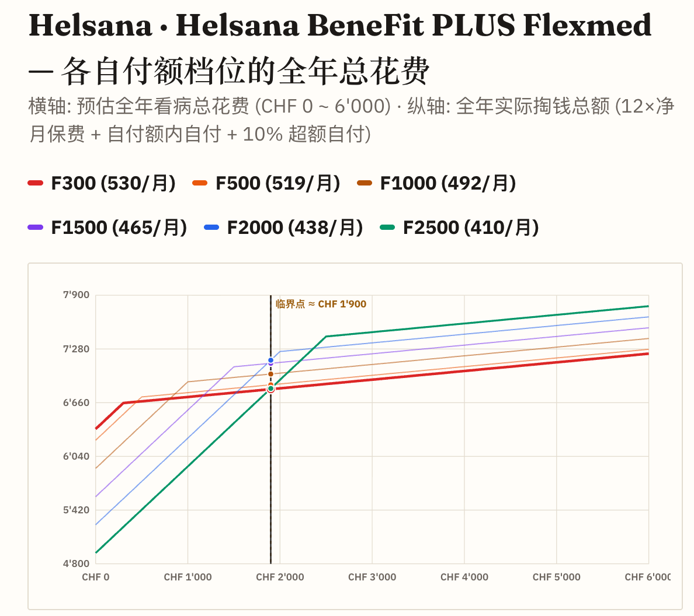
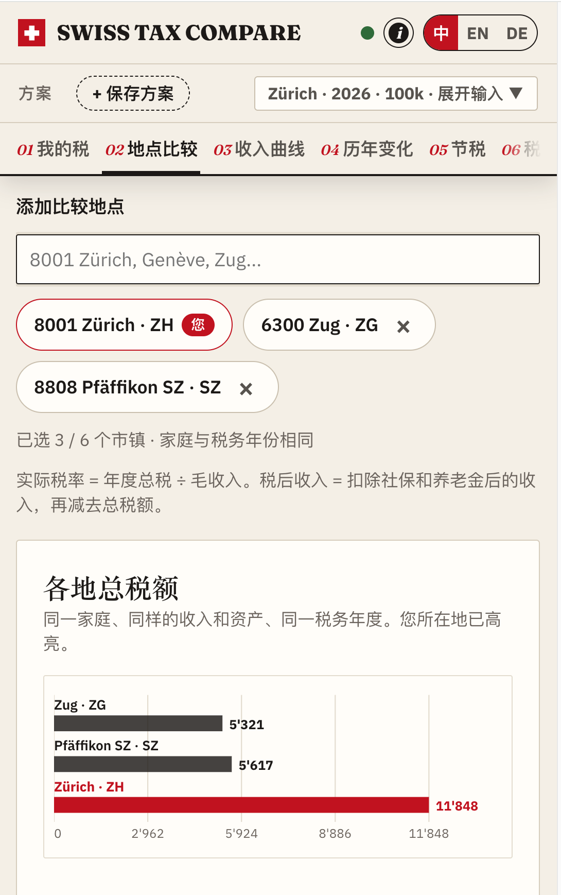

Title: Maxing周刊 EP14 2026w44: 大红果时代?
Date: 2026-11-01
Category: misc
Tags: weekly
Slug: maxing-weekly-ep14-2026w44

## news / 新闻
- [OpenAI又发布三大数学成果](https://mp.weixin.qq.com/s/Q8RWCJrpvZhbOS1yVlfaDA)
  - 证伪ETH猜想 / 全维度局部平滑猜想 / 杨-米尔斯场的存在性
  - 指数时间猜想居然是错的, 也就意味着很多困难问题会有更高效的解法, 虽然离P=NP还很远.
  - 全维度局部平滑猜想的证明可以直接导出全维度挂谷猜想, 而且使用的是和数学界几十年来完全不同的思路, 有点当年AlphaGoZero的感觉了
- [Gemini Carbon发布](https://blog.google/innovation-and-ai/models-and-research/gemini-models/introducing-gemini-4-carbon/) 
  - 从Argon后训练而来, 内部已经用上了
    - 之前3.8flash还偶尔会被气到想把它从TPU里揪出来暴打一顿; 现在opus/fable/argon/carbon这几个大佬模型 在我的日常任务上 体感基本上分不出来了...
  - benchmark上表现亮眼, 但是还没对外公布, 依旧贷款冠军... 估计全面发布的时候Fable5.5就来了
- [Genie4 世界模型发布](https://deepmind.google/blog/genie-4-a-new-generation-of-world-simulation/)
  - 会不会未来的RPG游戏 玩家就会在这种世界里探索? 不过目前来看还是实验性质...
- [微软给四分之一员工提供自愿离职选项](https://mp.weixin.qq.com/s/uBHcW3UXMvweRajTfawyHA)
- [谷歌Q3财报以后大跌10%](https://mp.weixin.qq.com/s/_DWxnG0ef9PR3zlYVt_Yrg)
  - 搜索广告增速放缓, 受AI mode拖累 -- 这也是两年前市场所担心的😱
  - 好像现在股票价格已经低过了巴菲特的成本价 -- 🐶是时候给巴菲特上一课了

## gems / 分享

### 播客: [知行小酒馆 E255 - 从「大结果」到「大红果」：你还相信越努力越幸运吗？](https://www.xiaoyuzhoufm.com/episode/6adb068cc96c8942ec110ee1)
- 第一遍听完 感觉他们的讨论很深刻, 我也和朋友聊到过类似话题, 但也就只聊到"现在的年轻人 只需要每个月吃泡面宅家刷手机 用不了多少钱就可以躺平" 这个层次而已, 而节目里的讨论要深刻很多
- 这期的后劲很大 有点上头 就听了第二次 又感觉, 对于具体的个人来说, 全部接受其中的结论的话有点危险. 
- 给人感觉是现在 *已经* 产能过剩, 再努力去做什么都没有意义 所以很多人刷红果 -- 或许是对这个社会思潮的解释 但是对具体的人来说 就有点管杀不管埋了吧!
- 🤔再思考一层 其中提到"生产过剩"甚至是各种东西"绝对过剩"的情况 其实 *还没有* 发生, 而且也应该怀疑是否会真正发生? 
  - 一方面别忘了杰文斯悖论™!! 需求会随着供应同步大幅提高
    - 而且即使到了可以养活全人类的地步, 我们不是还要探索*星辰大海*吗?!
  - 另一方面, 人类历史上从来没有出现过取消阶级人人富足平等的情形(这也是人性决定的). 现实是 人与人/国家与国家之间的不平等其实更加剧了.
- 感觉对于具体的人来说, 还是不应该放弃努力, 就像里面提到的, **不要等待**, 而应该*认真过好现在的生活*

> 2023 年的「四个确认」: **物价指数下滑 / 房地产过峰 / 人口负增长 / AI元年**

> **生产过剩的时代出现之后，那些意义来源、价值来源的支撑都消失了**
> 生产端的合法性被剥离了，但新的合法性没被建立起来
> 产能过剩、需求不足，甚至要反内卷、去产能。叙事改变，从生产端的伦理 → 消费端的伦理，但整个社会还没有适应新的叙事，也联想不到和自己有关系。
> 以后工作可能变成一种特权，消费才是本分 -- 在完全过剩的时代，努力的合法性好像被取消了?

> 最近几年的社会思潮变化:
> 历史进入垃圾时间(归因于时代) → 世界是个巨大的草台班子(归因于精英) → 爱你老己/主体性 → 黄毛/薄肌

> 要小心识别，什么是**当代的珠算**

> **自由很沉重，意味着你需要做所有的选择，并承担其后果**. 因为你所有的错误和生活的不幸，都要全然的为自己负责，没有“上层”可以归咎了

> **意义感是你把当下的自己托付给了未来, 并愿意为之承受痛苦**
> - 意义是基于时间的函数

> 不要问周期什么时候结束，因为你有了确切的时间后，就会开始等；而在等待的过程中，你所有的生活都不重要了，你的当下就没有了。 因为结果你无法预测，所以过程变得格外的重要。

> 兴高采烈地去犯错！去体验！去生活！人生没有标准答案

### 瑞士生活实用指南三则
[**初入瑞士工作要如何安顿自己**](https://docs.google.com/document/d/1m9sLr9zu-TuxIHMw93-7BE4kkf0y2fL3gJUveY3u2wo/preview?tab=t.0#heading=h.gsh5bvfcqe4k)
  - 这个是N年前有个微信群里的同事分享的, 最近有学弟要搬到苏黎世, 我就把它翻了出来
  - 本来想如果有空的话把它转载成微信公众号, 但这周事情太多了没有弄...

另外上周和这周, 还用官方网站的接口vibe了两个更用户友好的网站: 

**瑞士医保比价**: https://swiss-insurance-compare.vercel.app/
- 数据接口来自官方网站 https://www.priminfo.admin.ch/de/praemien
- 代码开源在: https://github.com/maxing-labs/swiss-insurance-compare
- 输入基本信息就可以看到所有保险公司的报价, 以及历史涨幅等信息
- 还做了一个"医疗费-vs-实际花费"的分析图像
  - 比较有意思的一个结论是: 如果预计一年医疗支出小于1900CHF就应该选最高免赔额(2500), 高于1900就应该选最低300的免赔额

**瑞士税率对比**: https://swiss-tax-compare.vercel.app/
- 数据接口来自官方网站: https://swisstaxcalculator.estv.admin.ch/#/home
- 代码开源在: https://github.com/maxing-labs/swiss-tax-compare
- 主要作用就是对比不同居住地的税率, 再加上一些税务科普

## misc / 杂记
### 运动
这周一次瑜伽两次力量
- 周一力量: 最近很累, show up 就是胜利, 非常划水
- 周三力量:
  - 深蹲8reps: 55kg-85kg-95kg-95kg
  - 卧推8reps: 50kg-60kg-64kg-60kg
- 周四瑜伽: 时隔两周 瑜伽老师终于回来了!
  - 开始前吊单杠82s, 结束后引体6个

### 🤖agents in practice

#### swiss-compare-xx
- 就是上面介绍的两个瑞士比较网站
- 从有想法到网站上线大约一两天的时间, 中间大约开了十个prompt session, 还是非常快的🚀
- 上线以后要发布, 在开源的时候我还在纠结要不要把最开始那些非常潦草的代码以及和LLM的对话总结剔除一下, 后来想了想, 这就是一个非常基础的网站. 而且 frankly speaking, **没有人在意你**, 别以为自己时刻都在别人的目光之下了. 于是把所有commits, 项目级提示词, 和AI聊天的所有artifacts都直接开源了出去.
- 开源之后还和Gemini聊推广的事情 它给了我一些想法 建议去reddit和X上宣传
  - 我替它注册好了账号以后就力竭了, 所以宣传的帖子现在还没发😂

#### antigravity帮我在最终期限之前修正了app
古法编程时代, [我在playstore发布了几个app](https://play.google.com/store/apps/dev?id=5572287189451726206&hl=en), 最近收到邮件, 必须要在11月1号之前迁移到android API36否则不能更新甚至会下架.
还好有antigravity, 我在它的chrome profile里登录了play开发者账号 让它自己在本机找这几个app的源代码文件夹, 然后升级版本编译发布. 
其中Flutter Catalog还遇到了policy的问题, 这以前是我最头疼的部分, 交给Argon帮我修改了app标题和截图等等, 终于在截止日期之前搞定了.👌

#### make zim great again
这周无意间看到 [zim官方支持markdown格式了](https://zim-wiki.org/manual/Help/Markdown_Syntax.html)
- 从2010年我就开始用zim写作, 这就是我体验过的最丝滑的笔记编辑功能
- 2024年还给它提交了一个[支持内部链接样式的PR](https://github.com/zim-desktop-wiki/zim-desktop-wiki/pull/2555) -- 这是我印象里最后一次古法编程
- 一直以来的痛点是它只支持wiki格式 而不是markdown
- 下载体验以后 感觉markdown支持得已经很完善了, 不过发现了一些问题, 正在和agent聊怎么修复和创建PR -- 还是那句话 "现在感觉自己强得可怕"😝
