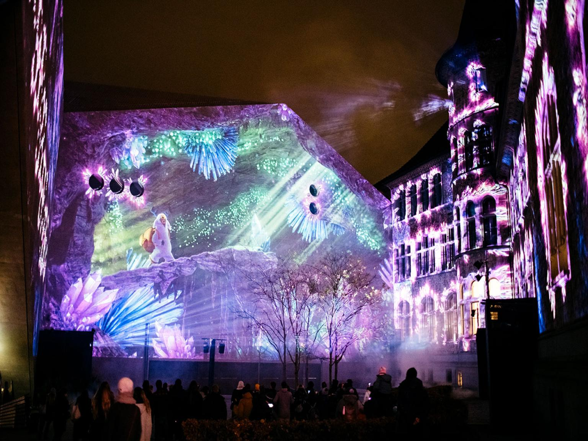
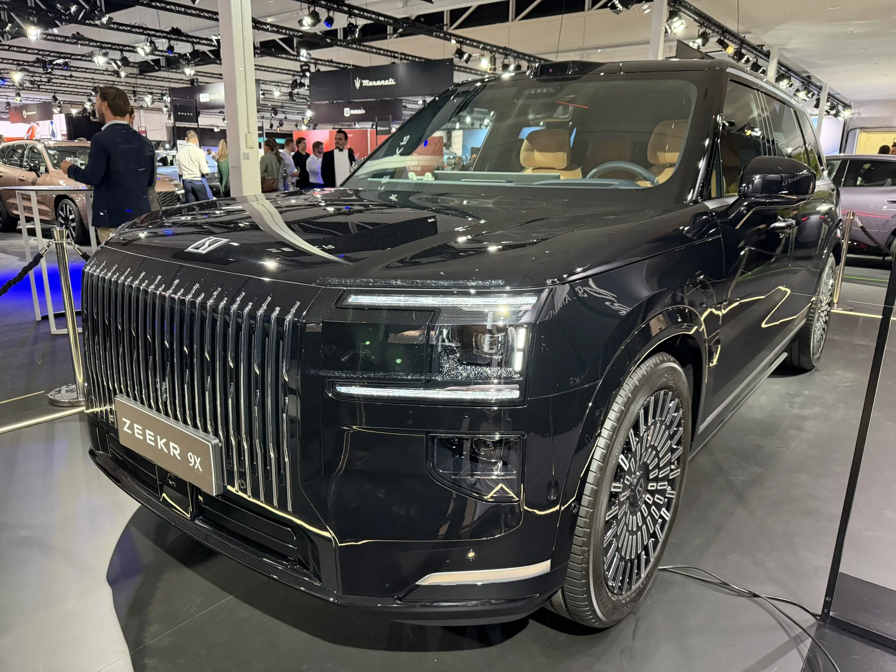

Title: Maxing周刊 EP15 2026w45: 黑白屏&彩色灯光秀
Date: 2026-11-08
Category: misc
Tags: weekly
Slug: maxing-weekly-ep15-2026w45

## news / 新闻
- 美国中期选举结束, 民主党参众两院大获全胜
- 民主党推出法案限制人工智能研究, 美股大跌
- 波兰第二大城市发生枪击案
- [Karpathy用Claude两小时复刻YouTube](https://mp.weixin.qq.com/s/JNsdGgIRbv0qbFtX47sOSg) -- [hackertube.org](https://hackertube.org/)

## gems / 分享

### Android app分享: [Graypause](https://f-droid.org/en/packages/com.lpw.graypause/)
- 用来把手机屏幕变黑白的开源应用
- 之前我用[DetoxDroid](https://github.com/flxapps/DetoxDroid), 但那个app几次更新以后黑白功能失效了, 于是改用这个
- 而且这个的模式改成了日常手机就是黑白色调, 需要时可以用快捷按钮用十分钟的彩色屏幕
- 实测下来确实用黑白色调刷小红书B站 感觉都没什么吸引力 一会就不想看了
- 而且我之前有一阵种草墨水屏手机 开了这个以后感觉和墨水屏也差不多了 还更丝滑

### UP主分享: [原子能](https://space.bilibili.com/162183)
- 非常Opinionated的编程/系统架构博主
- 之前解说一些云服务宕机事件的视频 简单易懂又犀利毒辣 看个乐呵 很下饭很好玩
  - [深度解读React满分漏洞，三个笨蛋合力炸掉半个互联网](https://www.bilibili.com/video/BV1uG2DBgEQ8)
- 另外还是全网最diss MySQL的博主, 和最推崇PostgreSQL的博主
- 最近的视频也在分享AI的使用 质量都不错
  - [做好人类的最后一次代码交接](https://www.bilibili.com/video/BV1gvpg6zEtT)

### antigravity自动化任务
用antigravity的`/automation`命令 可以互动式新建一个cron job. 我就建立了一个cron, 每天早上检查各大网站 盯着扫地机器人的价格折扣.

其实理论上这个还可以用来做好多事情, 比如自动签到, 自动发帖等, 甚至自动炒股🤑.

## misc / 杂记

### 运动
两次瑜伽一次力量
- 周二瑜伽: 开始前吊杠93秒, 结束后引体6个
- 周三力量:
  - 上斜卧推10reps: 30kg-40kg-45kg-45kg
  - 臀推10reps: 65kg-75kg-95kg-100kg

### 周末带娃
**[Illuminarium灯光秀](https://illuminarium.ch)**
- 就在HB旁边的瑞士国家博物馆, 有免费的entrance(排队比较久), 或者买灯光秀的门票可以快点进场
- 就利用博物馆的外墙进行灯光投影和音效, 看到现代的画面在古老的建筑上投影出来 有一种穿越的感觉 古人大概想不到未来有一天这些墙上会有这样的投影来供人娱乐吧

**[苏黎世车展](https://www.auto-zuerich.ch/en)**
- 周末去看 人山人海
- 好多中国品牌: 看到了iCar / MG / 智己 / 零跑 / BYD / 腾势 / 吉利 / Zeekr, 居然还有江淮JAC! 这些车都在瑞士卖, 价格基本上是国内两倍
- 排队最多的是Zeekr 9X, 外观确实霸气

