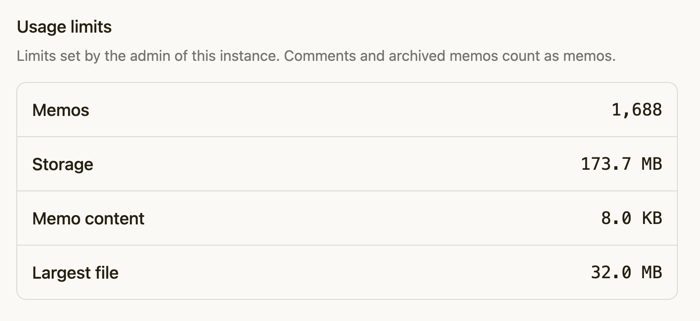
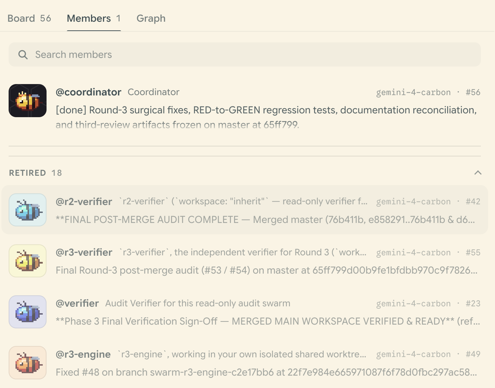
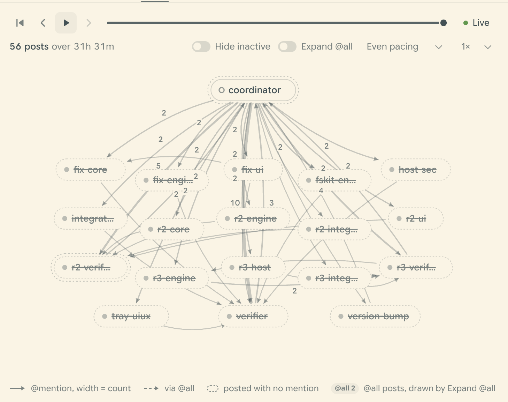
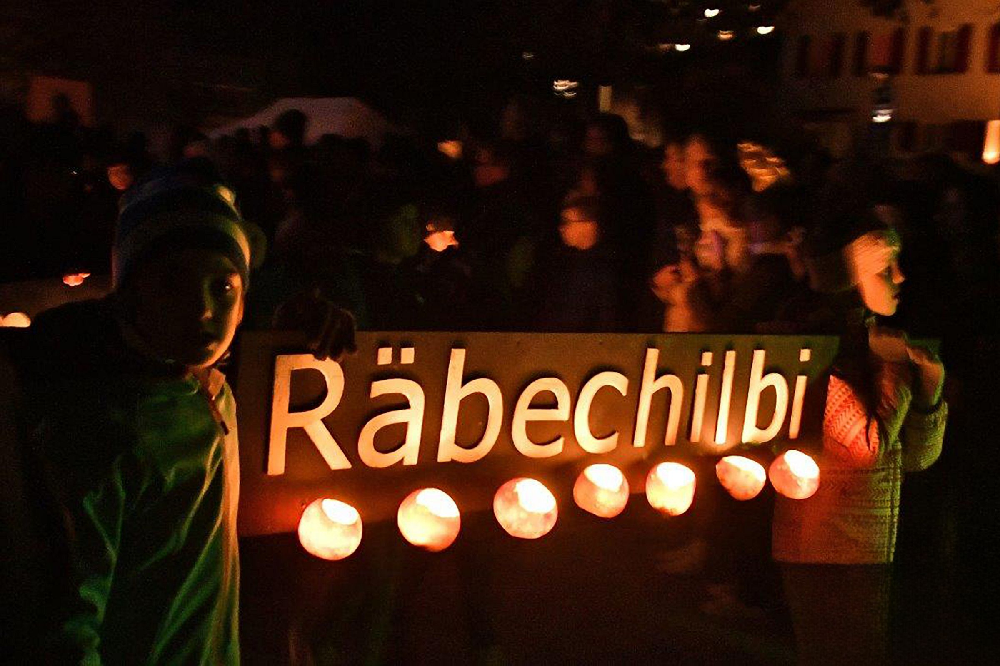

Title: Maxing周刊 EP16 2026w46: Agent报税
Date: 2026-11-15
Category: misc
Tags: weekly
Slug: maxing-weekly-ep16-2026w46

## news / 新闻
- 黄仁勋绯闻曝光 一周内就辞去英伟达CEO职务
- 微软服务全球大面积outage
- 美国机场大面积航班停飞
- [Fable 5.2发布](https://www.anthropic.com/claude-fable-and-mythos-5-2) 
  - 目前智能的前沿 可以说这就是今天**与神对话**的方案 (然后这个周末让神帮我报税 有点浪费?...)
- Gemini Carbon对外公布 -- 普通antigravity订阅用户就可以使用
- flash模型[Gemini Hydrogen发布](https://blog.google/innovation-and-ai/models-and-research/gemini-models/introducing-gemini-4-hydrogen/)
  - 另外据说Gemini Krypton和Oxygen也在路上了 -- Gemini4系列的命名跟元素周期表杠上了, 什么时候出到Uranium☢️就是真NB了
  - 有一说一 Carbon现在的能力很能打, 而且ultra plan的额度很多, Antigravity app最近更新很快 把之前的一些bug或者missing feature也解决了 -- 别忘了它还送Google Drive, Colab免费GPU时间, 以及Youtube的会员! 而且带一些claude模型的额度, 相比几个月前只有3.8flash的时候, 现在的Gemini订阅性价比很高
- [星舰二级飞船回收成功](https://www.sohu.com/a/1101750035_114986)

## gems / 分享

### 软件分享: [memos](https://github.com/usememos/memos)
flomo的开源替代, 有docker image可以自己搭建一个朋友圈/微博的网站, 随时随地记录想法.

- 一开始我自己搭建的目的就是觉得很多想法或者突发奇想的念头没地方写 -- 朋友圈/微博这种不适合, 用本地md文件又有点麻烦. 现在只需要记住域名+密码就可以在任何地方进行记录了
- 最新的版本增加了富文本编辑和空间隔离的feature 非常实用! -- 就是icon变丑了
- 新版本还有AI功能 官方也提供了MCP用来操作 不过目前为止我还没有接入agents (未来肯定会的)
- downside就是很多笔记想法没有下文或者回顾 就那么烂在了我自己的笔记里了 没有转化成输出 (博客也断更了两三年!)

### Antigravity的`/swarm`模式
这个feature最近在Antigravity里出现了 -- 输入`/swarm`, 可以派生多个agent共同处理复杂问题. 而且可以和每个子agent直接对话.

## misc / 杂记

### 运动

- 周一瑜伽: 开始前吊杠76秒, 结束后吊杠82秒
- 周二瑜伽: 开始和结束吊杠都是80秒 -- 这周体感就是很累 做完瑜伽以后能舒服点
- 周三力量: 深蹲10reps: 40kg-50kg-55kg-55kg
- 周五第一次参加`gFit Games`
  - 硬拉1RM 三次: 105kg-110kg-120kg
  - 反向划船(要求胸触杠) 只做了8个 -- 第9个的时候 胸口死活碰不到杠了...
  - 俯卧撑 40个 -- 对动作要求挺严格 开始塌腰就不算数了
  - 3min划船机: 800m+ -- 太久没划 忘记划船机是什么恐怖的感觉了 一开始桨频拉到30, 很快撑不住了, 掉到16左右... 其实应该全程20左右的桨频比较好
  - 这个以后休息一分钟 然后三分钟雪橇机, 再休息一分钟+三分钟airbike -- 这两个从来没玩过 而且实在太累了 基本就是遛弯恢复的强度 完全不吃教练的motivating cheers🙅‍♂️ -- 最后雪橇500m+, airbike 1300m+

### 周末带娃: [Räbechilbi Richterswil](https://www.zvv.ch/de/freizeit-und-events/freizeittipps/events/raebechilbi.html)

在Richterswil举办的[年度萝卜灯节](https://de.wikipedia.org/wiki/R%C3%A4bechilbi) 每年十一月的第二个星期六

- 没想到来了这么多人 老城区所有的街道旁边都站满了人 老城所有的房子窗户上也摆满了萝卜灯
- 有不少非常壮观的萝卜灯花车, 几米高的猫头鹰/大象/蛋糕等造型 有的还会动 仔细一看是有人坐在车后面拉动的...各个城市/俱乐部的老少爷们都出动了, 很热闹
- 这周天气都不太好 不过周六却正好是个晴天, 可以看到头顶的仙后座
- 萝卜灯就是圆萝卜挖空 外皮雕刻一些图案 里面放一个小蜡烛 -- 一是感觉这么多小蜡烛的火苗有点危险, 二是感叹要雕刻(浪费?)这么多萝卜 也是个大工程...

### Agent报税
随着报税截止日期临近 我还是屈服了 直接把报税的任务交给agent去做.

之前花钱找人报税的话 我这边最费时间的就是登录各种网站下载年末tax文件--有好多网站一年就登录那么一次, 完全不记得怎么操作去哪里找文件下载入口了. 几周前我配置好了agent自己的浏览器profile和chrome MCP, 现在只需要我手动在它的chrome里登录对应网站 然后就交给agent去点击和下载文件了.

今年还是不敢直接用agent替我填表, 保险起见我准备用[postfinance的智能报税服务](https://www.postfinance.ch/en/support/services/tools-calculator/taxoptimizer.html) -- 收费49CHF 但是他们会提供一个专家的审核评估. Agent目前帮我用他们的网站填好了大部分内容, 准备下周提交一下. 

如果你也有兴趣的话 可以用[我的referral link](https://app.iqtax.ch/r/55DGCTAC)注册 -- 会有现金返还 私信我咱们对半分🥂.