Title: 瑞士学车记3.1 - 苏黎世路考通用交规、停车要领与常见路标
Date: 2021-05-08
Tags: swiss
Slug: swiss-driving-test-3-1
Series: 瑞士学车记
Series_index: 3

从这一篇开始进入路考实战部分。这里先整理我平时跟着教练练车时记下来的**通用驾驶习惯、停车要领、瑞士高频交规坑点**，以及一套常见瑞士路标图解。

## 1. 基础驾驶与停车要领

- **日间行车灯**：开车前先确认打开车灯（Mandatory daytime running lights），在瑞士白天开车也必须开近光灯或日行灯。
- **车道位置参考**：如果自行车道的标线从驾驶位往前看刚好在雨刷正中间附近，车身差不多刚好没有压线；也可以随时结合右侧后视镜确认边距。
- **路口跟车停车距离**：以**引擎盖下沿不要挡住前车后轮轮胎**为参考标准。

### 侧方停车要领

1. 提前打右转向灯，向后方示意。
2. 往前开到后排座位与目标车位前线对齐。
3. 方向盘向右打满，倒车转到车身约 45 度。
4. 回正方向盘，继续向后退，直到左后轮（或后轮）压到车位左线。
5. 方向盘向左打满，顺势停入车位并微调摆正。

### 倒车入库要领

1. 车身与车位横向保持约 2.5 米间距（大约中间还能过一辆车的宽度）。
2. 往前开到约 2.5 个车位处、肩膀对齐参考点时，方向盘向右打满倒车入库，观察两侧后视镜随时修正。

## 2. 瑞士高频交规与路考要点

### 默认限速

瑞士全境如果没有额外限速牌，默认限速如下：

- **市区/建成区（Innerorts / within built-up areas）**：`50 km/h`
- **城外普通公路（Ausserorts / outside built-up areas）**：`80 km/h`
- **高速公路（Autobahn / motorway）**：`120 km/h`

### 变道与观察

- 变道前必须按顺序观察后视镜与盲区（内后视镜 + 侧后视镜 + 扭头看侧窗盲区），然后**一定要提前打转向灯**。

### 右侧优先（Right of Way / Rechtsvortritt）

这是瑞士路考最容易挂科的考点之一：

- 直行经过右侧有岔路时，**默认右侧来车拥有优先权**，必须减速并明显向右转头观察有没有来车。
- **例外情况（无需礼让右侧）**：
  - 右侧岔路口有**路缘石/道牙子**（Trottoirüberfahrt）时，右侧车没有优先权。
  - 右侧岔路口地上画了**倒三角形让行线**（Kein Vortritt）时，无需让右侧。
  - 当前道路有**黄色菱形主路标志**（Hauptstrasse）时，拥有优先权，不用让右侧。
- 一旦看到主路解除标志（黄色菱形加黑斜杠），后续路口通常就会恢复右侧优先，务必重新开始向右观察。

### 自行车道（Velostreifen）

- 路面上没有自行车时，必要情况下可以稍微借用一点虚线自行车道。
- 但在路口等红灯停车时，**需要给右侧自行车留出通行空间**，尽量不要把自行车道堵死。
- 如果前方有自行车，在安全且视野良好时果断加速超过（保持足够横向安全距离）。
- **在人行横道附近绝对不可以超车**，因为视野受阻且路面较窄，非常危险。

### 拐弯与路口标线

- **拐弯原则**：
  - 拐弯过程中严禁随意变道，严格顺着地面导流线行驶。
  - 在小路口右拐时要**尽量靠右**，否则对向有车想拐进来时会没有空间。
- **STOP 线**：
  - 看到地上的 `STOP` 标线或八角形停牌，**无论路口有没有车和行人，都必须把车完全刹停**（停稳约 2–3 秒），确认安全后再起步。
  - 左拐时绝对不能压到左侧对向车道的 STOP 线，宁可绕大一点的弯。
- **倒三角让行线（Triangle / Wartelinie）**：
  - 有些红绿灯路口地面画着一排小倒三角形，位置通常比红绿灯停止线更靠前。
  - 白天红绿灯正常工作时，要停在前面的**实白线**处等灯；这条三角形线一般只在夜间信号灯关闭时作为让行停车参考。

### 环岛 / 转盘（Roundabout / Kreisel）

- 进环岛前，**环岛内左侧来车拥有绝对优先权**。
- 进环岛时车速要慢（一般控制在 `20 km/h` 以下）。
- **出环岛前必须提前打右转向灯**，同时特别留意右侧可能直行的自行车和过街行人。

### 高速公路（Autobahn）

- 瑞士高速严格执行**靠右行驶原则**（Rechtsfahrgebot），左侧车道仅用于超车。
- 进入高速并看到地面变为虚线后，安全观察并打灯逐步并入最右侧行车道。

### 铁路道口

- 遇到铁路道口栏杆放下或红灯闪烁等待火车通过时，需要**完全停车熄火、拉手刹并关闭近光灯**（避免晃到对向车辆）。
- 等栏杆完全抬起且**警示红灯彻底熄灭**后再起步通过。

### 公交站与有轨电车（Bus / Tram）

- 从路边凸出的公交停靠区或实线公交专用道不可随意占用；遇到公交车打左灯准备出站时，在市区路段通常需要礼让。
- 苏黎世市区 Tram 线路极多，注意 Tram 的优先权及路口盲区（后续具体路线篇会结合实景截图详细拆解）。

## 3. 瑞士常见交通标识速查

更多完整标识可参考：[Road Signs in Switzerland (e-university.ch)](https://www.e-university.ch/index.php/en/e-driver-driving-theory-test/road-signs-in-switzerland)

- **高速公路（Autobahn）**：

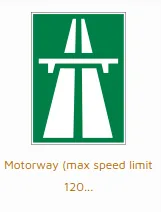

- **主路（拥有优先权）**：

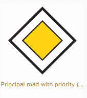

- **STOP（必须完全停车）**：

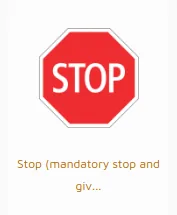

- **单行道（允许驶入方向）**：

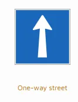

- **单行道禁止驶入（另一侧）**：

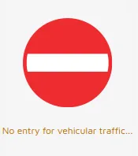

- **双向所有车辆禁止通行**：

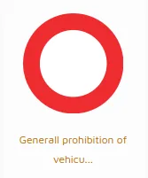

- **机动车禁止通行**：

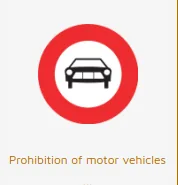

- **禁止停车**：

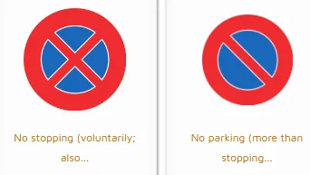

- **会车优先权（让行 / 优先于对向来车）**：

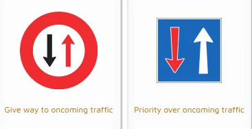

- **最高限速**：

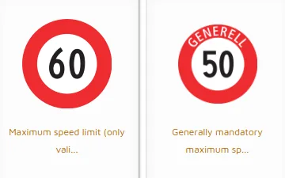

- **最低限速**：

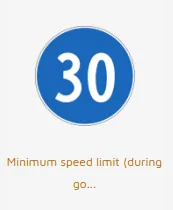
