Title: 瑞士学车记3.2 - 苏黎世 STVA 路考路线复盘：教练带练高频路段（Markus）
Date: 2022-03-02
Tags: swiss
Slug: swiss-driving-test-3-2
Series: 瑞士学车记
Series_index: 4

这一篇记录的是考前跟着我的教练 **Markus** 在苏黎世交管局（STVA Albisgütli）周边实车带练的两条核心高频路线，涵盖了南下湖西线（Enge / Wollishofen / Kilchberg / Thalwil）以及西线高速与山区（Wettswil / Birmensdorf / Uitikon / Leimbach）。每处截图都是实操中极易踩坑的点位。

---

## 路线一：STVA → Enge → Wollishofen → Kilchberg → Thalwil

**路线概览**：`STVA -> L（左转出考场）-> Enge -> Wollishofen -> Kilchberg -> Thalwil`

- **从 STVA 左转出考场**：这个路口不仅要回头看左后方的 Tram，还要**特别注意人行横道上的行人**！

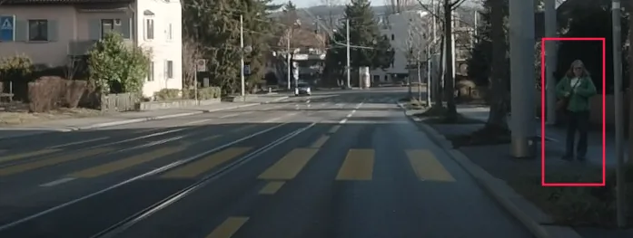

- **路口等红灯**：尽量不要占用右侧自行车道。

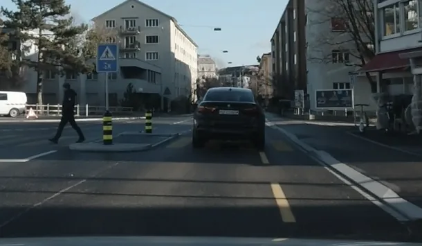

- **独立信号灯**：这个路口直行是单独的红绿灯，千万别看错相邻车道的灯。

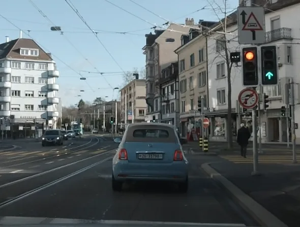

- **Enge 路段**：这个地方要往前开到最前面，再慢速切入 Tram 车道。

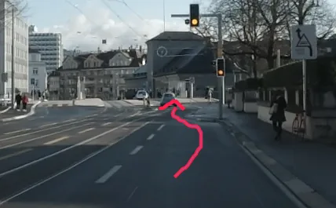

- **Enge 火车站**：右转前往 Wollishofen 方向。

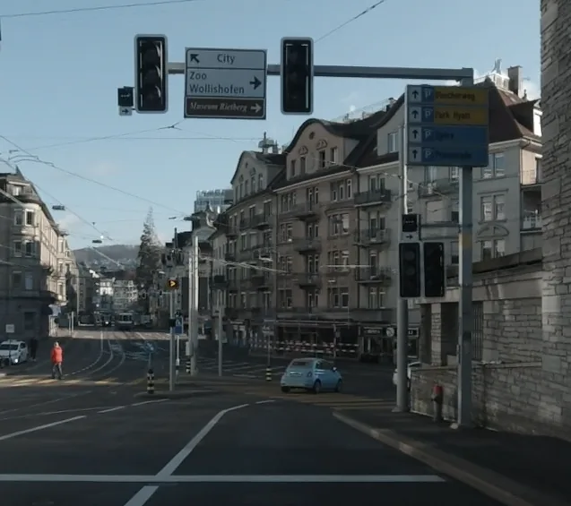

- **窄路借道**：这一段开的时候可以稍微借用一下左边车道，否则右侧很容易蹭到路边障碍物。

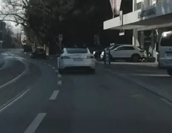

- **下坡会车观察**：前方经常有很多车顺着下坡开过来，一定要提前仔细观察。

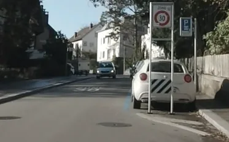

- **Brunau 附近 30 Zone 路口**：从 Brunau 那个 30 Zone 的路口左拐以后，紧接着这个 **Right Priority 一定要看远一点**，公交车随时可能从右侧开过来！

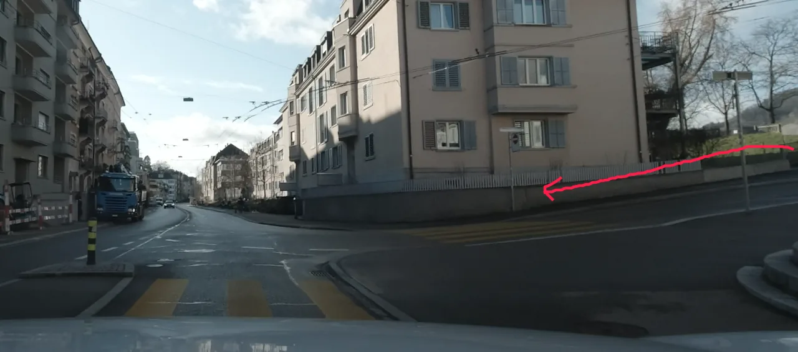

- **持续 30 Zone**：一直开到这里依然还是 `30 Zone`，千万别提前加速！

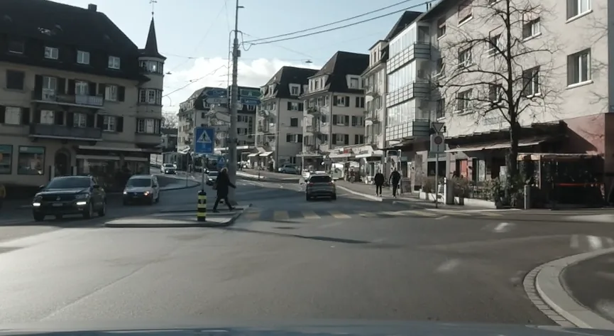

- **从 Wollishofen 汇入主路**：

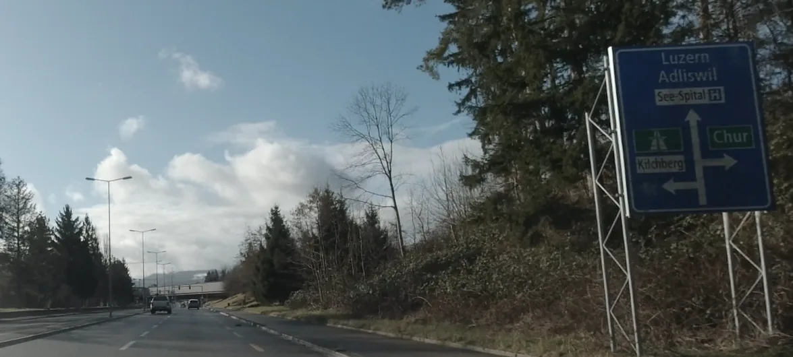

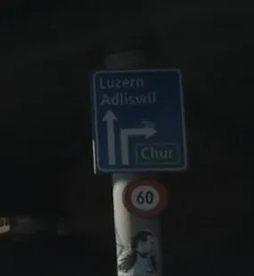

- **前往 Spital / Kilchberg 方向**：这里路面比较窄，没有自行车时可以适当借用自行车道。

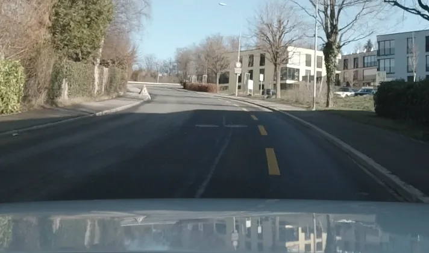

---

## 路线二：Thalwil → Brunau → Wettswil → Birmensdorf → Uitikon → Triemli → STVA → Leimbach

**路线概览**：`Thalwil -> Autobahn -> Brunau -> Wettswil -> Birmensdorf -> Uitikon -> Triemli -> STVA -> Leimbach -> Thalwil`

### 高速与 Wettswil 路段

- **Brunau 高速堵车**：在高速公路上遇到拥堵缓行时，如果你是**队列里的最后一辆车，需要打开双闪警示灯**提醒后方来车。

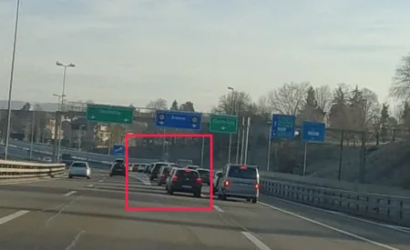

- **Autobahn（Bern / Basel 方向）出隧道去 Wettswil**：出隧道后的最右侧车道就是去 Wettswil 的，注意此处**限速 80**！

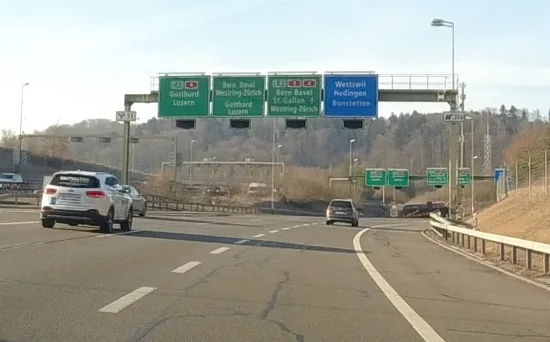

- **路口分流**：左拐是 Wettswil / Luzern 方向，右拐是 Zürich / Birmensdorf 方向。

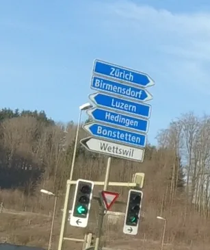

- **Wettswil 入口**：是在**第二个红绿灯**处左拐。

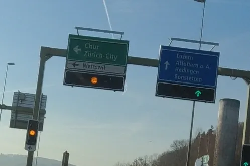

- **解除 50 限速后别急着提速**：Wettswil 解除 `50` 牌子之后不要猛加速，弯道/山坡（Whisky Pass）就在正前方！

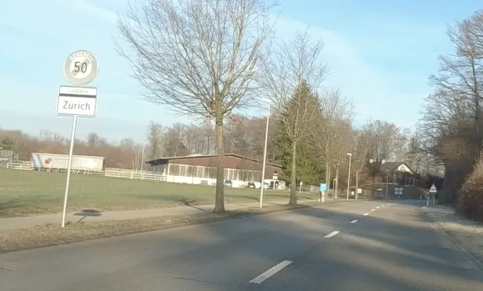

- **下坡后左拐去 Birmensdorf**：这一段视野开阔，可以正常提速。

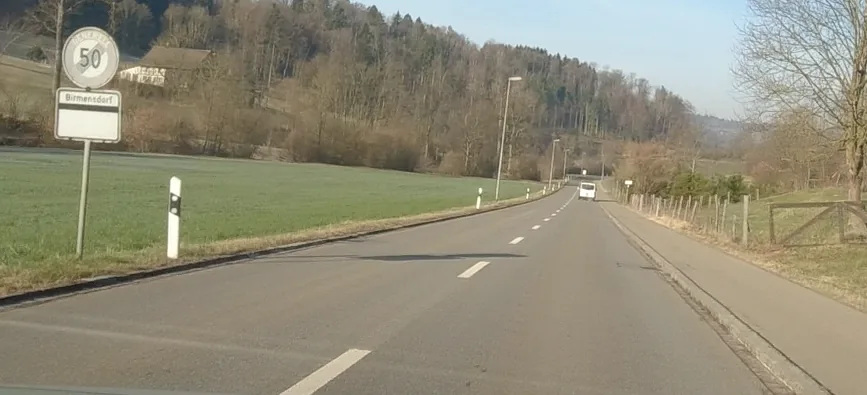

### Birmensdorf 路段

- **隐蔽的右侧优先**：刚开进 Birmensdorf 不远就有一个 Right Priority，刚好藏在广告牌后面，极易漏看。

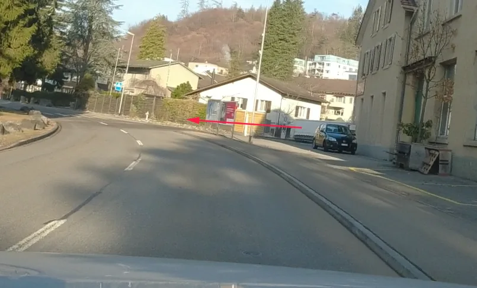

- **大弯拐入**：这种视野受限的路口拐进去时要走大弯（Big Corner），默认假设里面随时会有车开出来。

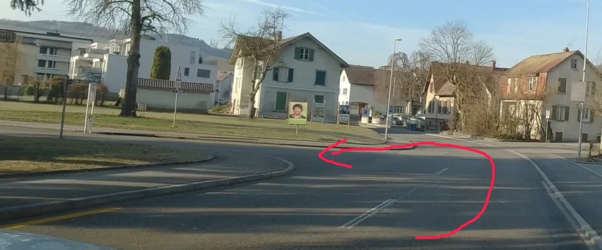

- **铁轨前等车**：绝对**不要停在自行车道上**！

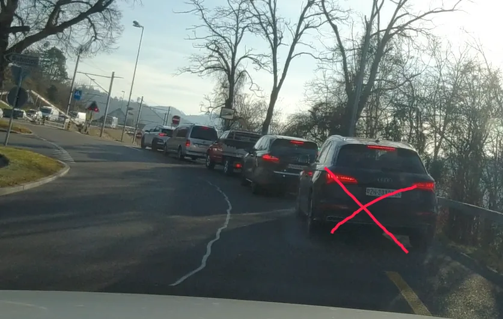

- **通过铁轨前确认前方路况**：如果铁轨前方正在堵车，**绝对不要开上铁轨**，必须停在铁轨外等待！

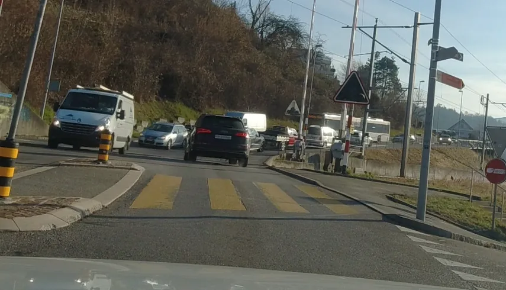

### Uitikon 路段（石头柱子密集区）

- **30 Zone 后的 Right Priority**：Uitikon 这个 `30 Zone` 后面紧挨着就是一个 Right Priority！

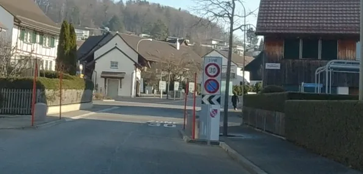

- **出 30 Zone 的 Right Priority**：出 `30 Zone` 的时候同样紧跟着一个 Right Priority！

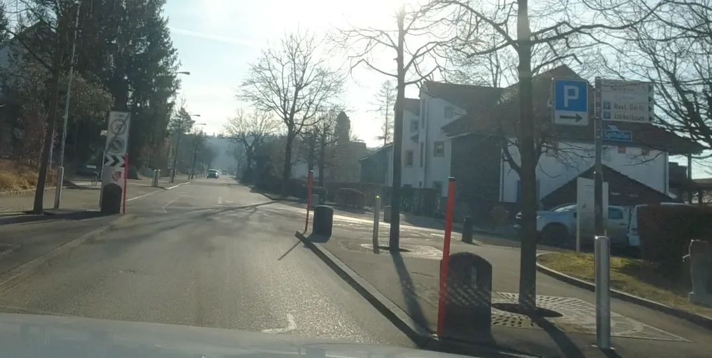

- **Uitikon 的 Migros 停车场**：**绿色地面区域是入口**，同时注意出口也是那片绿地。

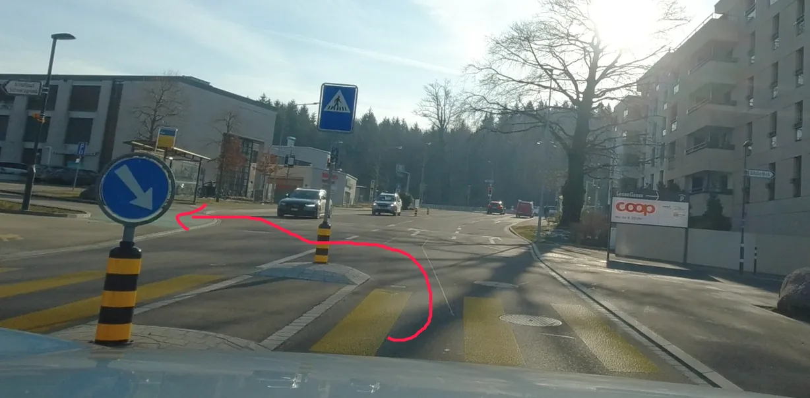

### 返回苏黎世市区 & STVA

- **回 Zürich 方向**：

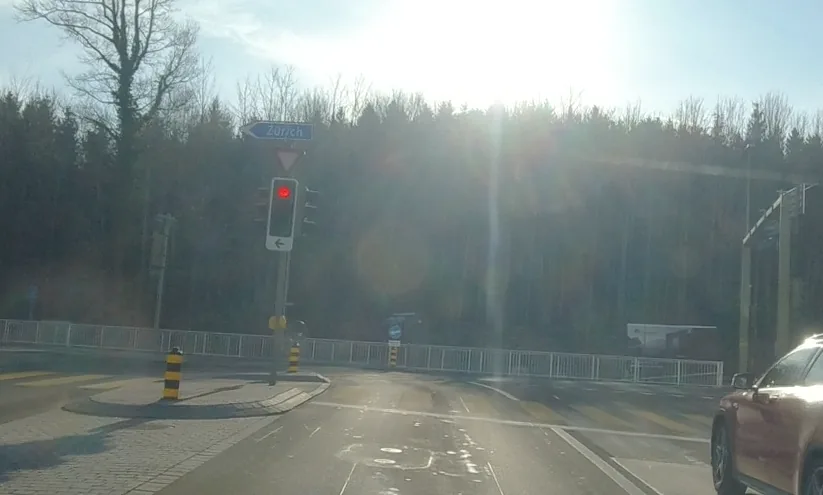

- **变道靠右 + 长下坡控速**：过了拐弯变成两条车道，应该并到右侧车道；另外往后基本都是长下坡，需要轻带刹车时刻注意控制车速，一直开回城里就到 Triemli 医院附近了。

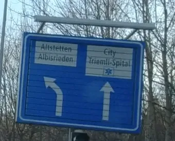

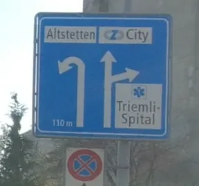

- **前往 STVA 路口**：右拐时注意观察右侧自行车，红灯停车时也要给右侧留出空间。

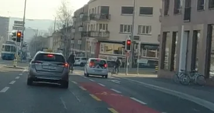

- **STVA 门口左拐**：千万不要抢黄灯，Tram 会非常快速地开过来！

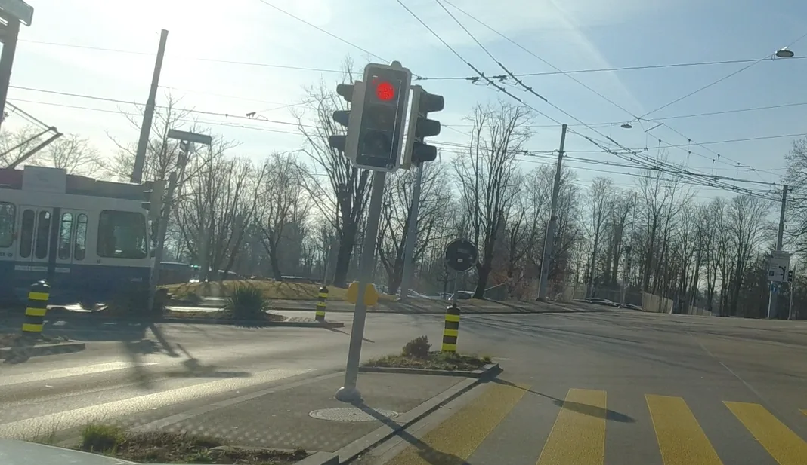

### Leimbach 与 Adliswil 路段

- **Leimbach 超长 30 Zone**：这一整段非常长，全都是 `30 Zone`，一直要开到 Adliswil 才会恢复 `50`。

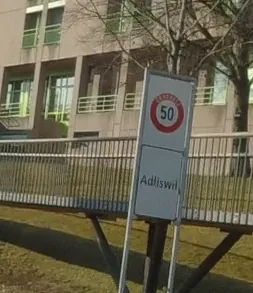

- **Adliswil 隐蔽 Right Priority**：一个非常容易忽视的右侧优先路口。

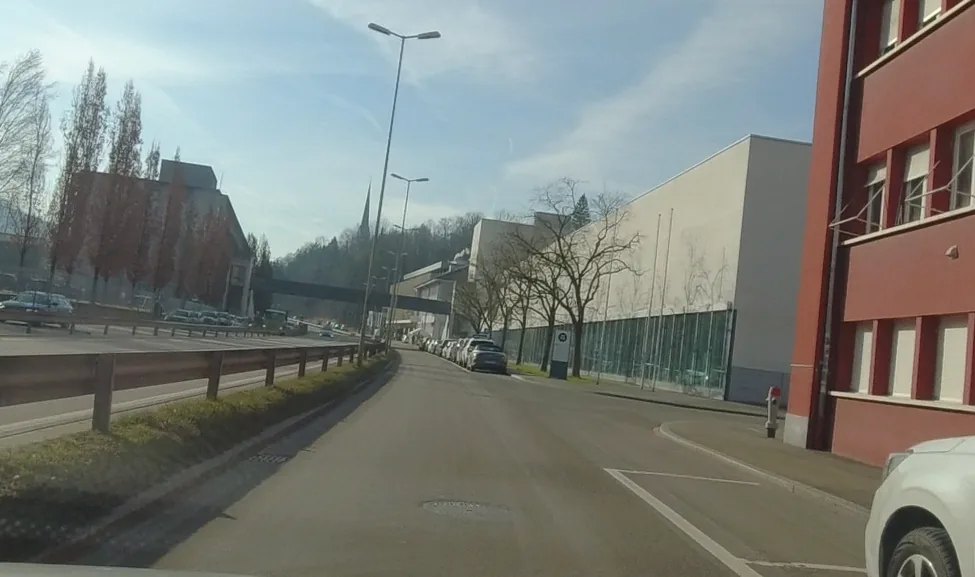

- **过桥洞后的 Right Priority**：刚穿过桥洞紧接着又是一个右侧优先路口。

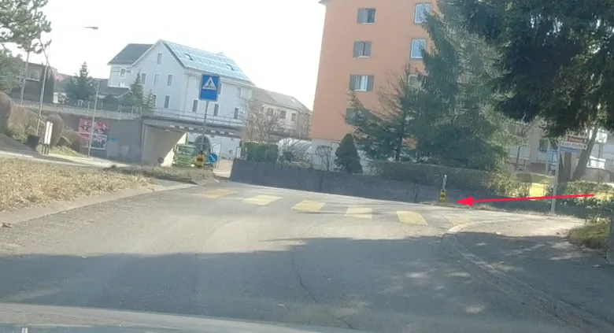
