Title: 瑞士学车记3.3 - 苏黎世 STVA 路考路线复盘：湖西岸与 A3 高速片区（Wollishofen / Kilchberg / Thalwil）
Date: 2022-03-01
Tags: swiss
Slug: swiss-driving-test-3-3
Series: 瑞士学车记
Series_index: 5

考前我系统刷了苏黎世驾校教练 **Nils Hommel** 在 YouTube 上发布的大量 STVA 真实模拟路考视频（强烈推荐他的频道 [Nils Hommel](https://www.youtube.com/@NilsHommel)，非常适合考前“云踩点”）。

接下来三篇将这 11 套模拟路考视频复盘按苏黎世地理片区分类整理。本篇聚焦最高频的**湖西岸与 A3 高速片区**（覆盖 Enge、Sihlcity、Wollishofen、Kilchberg、Rüschlikon、Thalwil），共收录 5 套完整模拟路线（10 段视频）。

---

## 路线 1：Ardita（Enge → Sihlcity → Wiedikon → STVA → 高速 → Wollishofen → Kilchberg → Enge）

**路线概览**：`Enge -> Sihlcity -> Wiedikon -> STVA -> Autobahn -> Wollishofen -> Kilchberg -> Autobahn -> Sihlcity -> Enge`

### Teil 1

<iframe src="https://www.youtube.com/embed/H5qmlmZkFww" title="YouTube video player" style="width: 100%; height: 100%; border: 0;" allow="accelerometer; autoplay; clipboard-write; encrypted-media; gyroscope; picture-in-picture" loading="lazy" allowfullscreen></iframe>

- 从 Enge 出发：又是那个前方和左侧都禁止通行的路口，只能右拐。
- Sihlcity 路口**右拐**（Wiedikon 方向）。
- Wiedikon 附近有两处容易忽略的**禁止通行**标志：

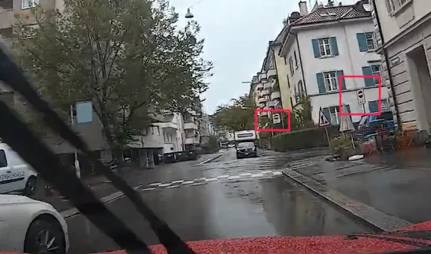

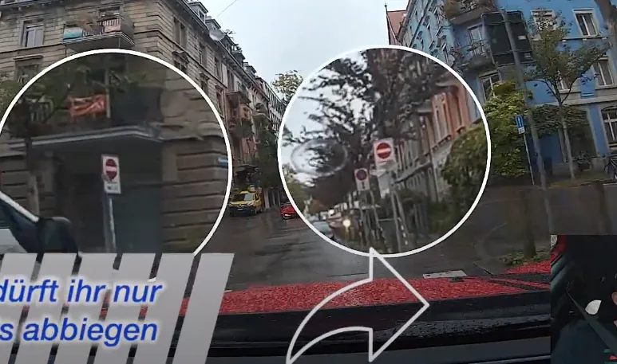

- **这个路口左拐不仅要看对向来车，还要特别注意有没有行人正在过马路**！

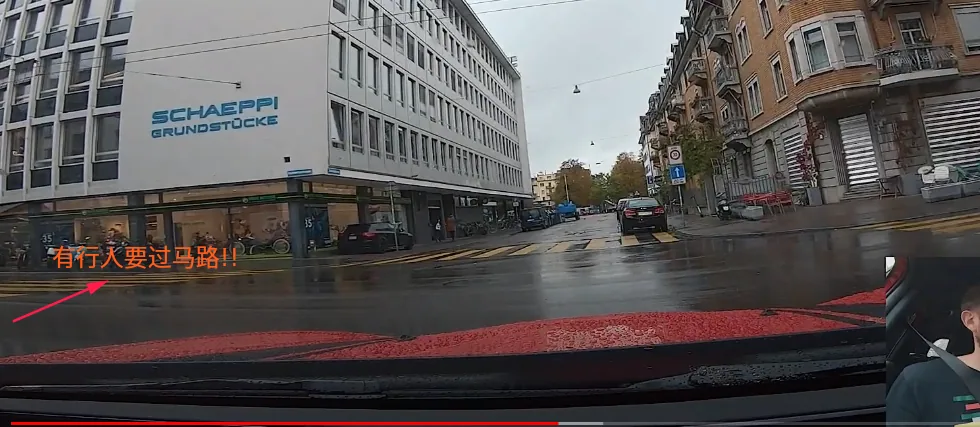

- 回到 STVA 路口 → 上 A3 高速（Chur 方向）→ Wollishofen 下高速。

### Teil 2

<iframe src="https://www.youtube.com/embed/CLFUGwX26fU" title="YouTube video player" style="width: 100%; height: 100%; border: 0;" allow="accelerometer; autoplay; clipboard-write; encrypted-media; gyroscope; picture-in-picture" loading="lazy" allowfullscreen></iframe>

- 当街道比较窄且没有自行车时，可以适当借用自行车道：

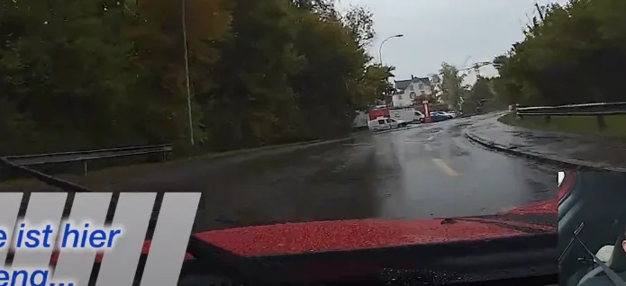

- Wollishofen 开往 Kilchberg（经过那条周日禁止通行的路段）。
- **Kilchberg 不明显的路口**：要从右侧车道再左拐，同时注意这里也是 **Right Priority**！

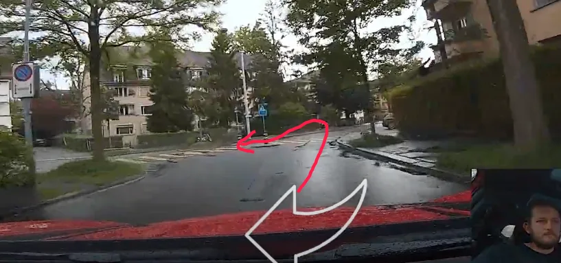

- 从 Kilchberg 上 Autobahn（Zürich City 方向）→ Sihlcity → 路过 Google 办公楼旁 → 返回 Enge。

---

## 路线 2：Charles（STVA 左转 → Sihlcity → Wollishofen 沿湖 → Kilchberg → Thalwil 上高速 → STVA）

**路线概览**：`STVA (L) -> Sihlcity -> Wollishofen Seestrasse -> Kilchberg -> Rüschlikon -> Thalwil Autobahn -> STVA`

### Teil 1

<iframe src="https://www.youtube.com/embed/0ux-rmKhRlM" title="YouTube video player" style="width: 100%; height: 100%; border: 0;" allow="accelerometer; autoplay; clipboard-write; encrypted-media; gyroscope; picture-in-picture" loading="lazy" allowfullscreen></iframe>

- 出考场左转（Links），在 Wiedikon 前再次左拐。
- 遇到前方大车准备掉头时，**离远点停下等它完成掉头**：

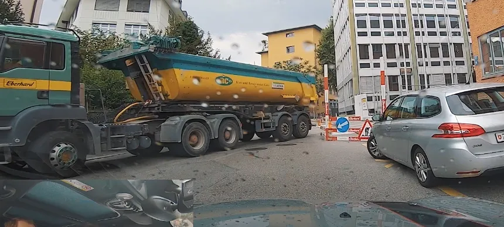

- 注意这里的**禁止通行**标志；另外转进去之后是很长一段没有额外重复提醒的 `30 Zone`：

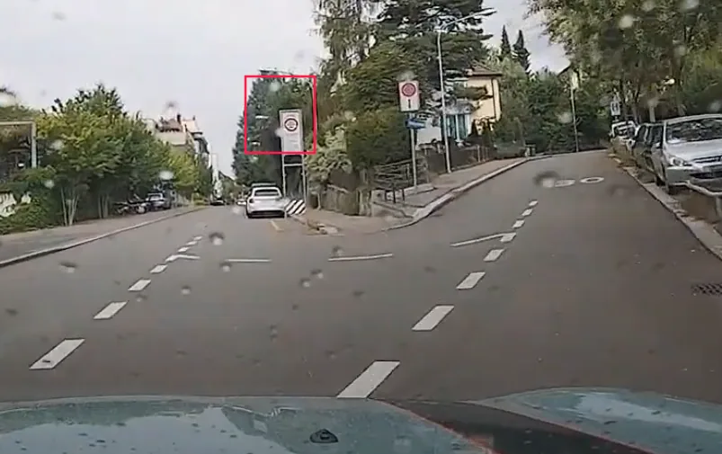

- 这里的 `30 Zone 结束` 路标非常隐蔽、很难看见：

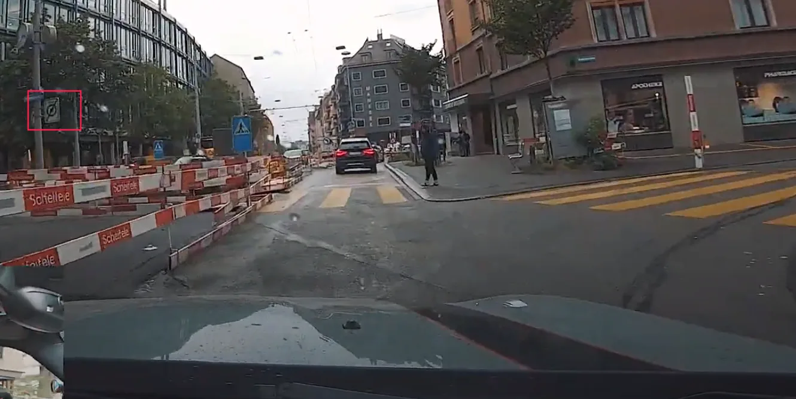

- 从 Sihlcity 去 Wollishofen 方向（Google 办公楼后面）：

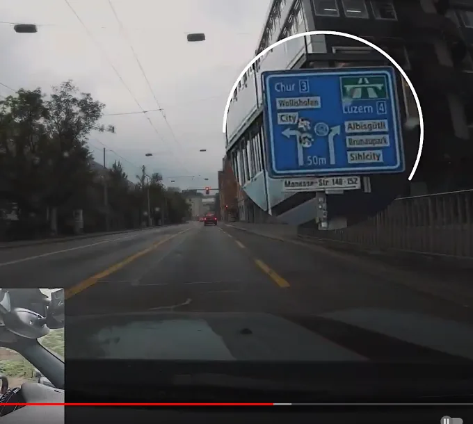

- 这个路口左拐时，**可以借用 Tram 轨道（白色虚线区域）**等待：

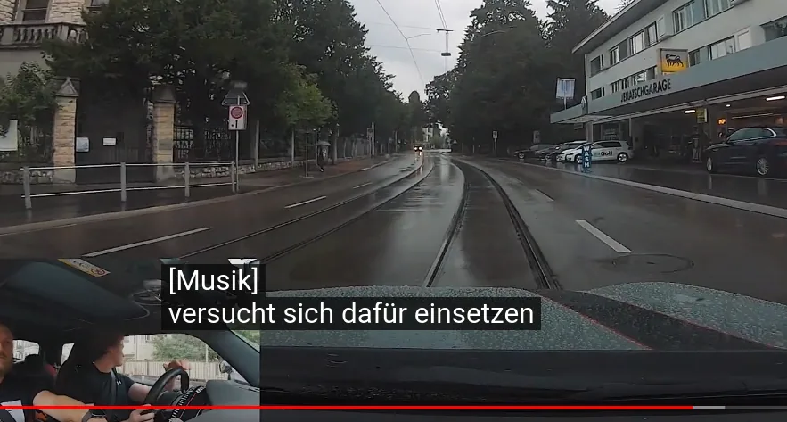

- 随后沿着湖边 Seestrasse 开往 Wollishofen。

### Teil 2

<iframe src="https://www.youtube.com/embed/vxshsv-vF70" title="YouTube video player" style="width: 100%; height: 100%; border: 0;" allow="accelerometer; autoplay; clipboard-write; encrypted-media; gyroscope; picture-in-picture" loading="lazy" allowfullscreen></iframe>

- 沿着 Seestrasse 开到 Kilchberg：**进桥洞前先看清楚反光镜**，如果对面有大车过来绝对不能硬开进去！

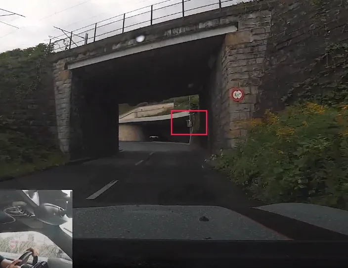

- 继续开到 Rüschlikon，随后从 Thalwil 出口附近汇入 Autobahn 返回 STVA：

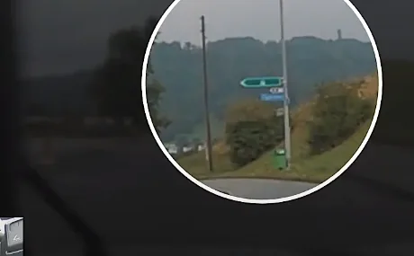

---

## 路线 3：Jasmin（Enge → Sihlcity → Wollishofen → Kilchberg → 高速 → Wollishofen）

**路线概览**：`Enge -> Sihlcity -> Wollishofen -> Kilchberg -> Thalwil/Rüschlikon Autobahn -> Wollishofen`

### Teil 1

<iframe src="https://www.youtube.com/embed/AVh79Uw_V_o" title="YouTube video player" style="width: 100%; height: 100%; border: 0;" allow="accelerometer; autoplay; clipboard-write; encrypted-media; gyroscope; picture-in-picture" loading="lazy" allowfullscreen></iframe>

- **一个非常不明显的死路（Sackgasse / 禁止通行）**：

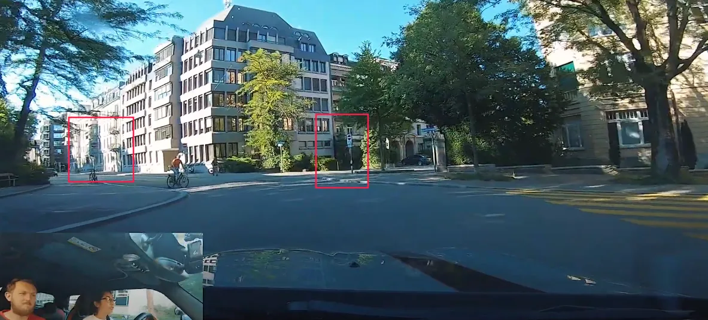

- 在 Enge 附近左拐，可以在 Tram 轨道上停着等待对向车流：

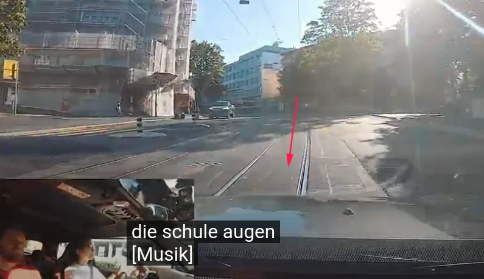

- 拐到 Enge 附近教堂的路上：

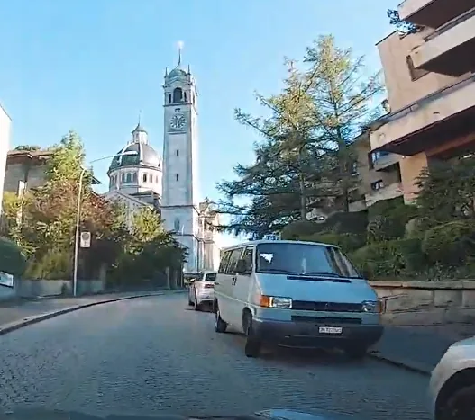

- **下坡时注意前方的死路标志**：

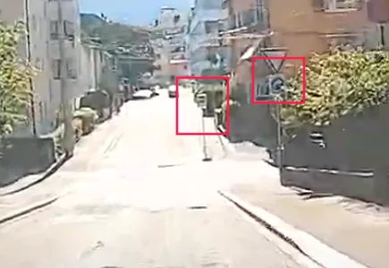

- **Sihlcity 路口**：地面是斜 45 度方向的导流箭头，顺着走**不用打转向灯（Blinken）**：

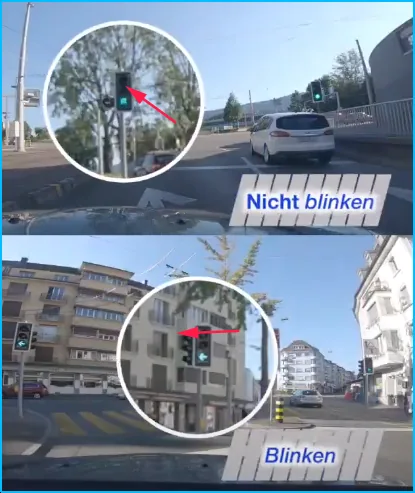

- 沿高速旁边的 `60` 限速路往 Luzern 方向开，然后往 Wollishofen 拐入（后续进入 Kilchberg 路段有非常多 Right Priority）：

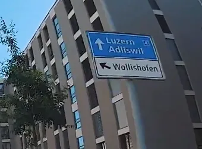

### Teil 2

<iframe src="https://www.youtube.com/embed/KqnnbbGZX7E" title="YouTube video player" style="width: 100%; height: 100%; border: 0;" allow="accelerometer; autoplay; clipboard-write; encrypted-media; gyroscope; picture-in-picture" loading="lazy" allowfullscreen></iframe>

- **Kilchberg 刚出 30 Zone 的 Right Priority**：

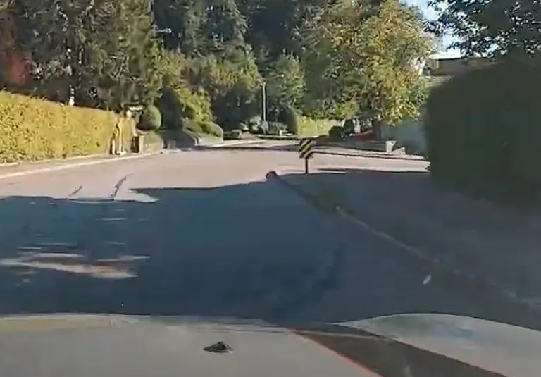

- **Kilchberg 周日限行路段**：注意看辅助牌，这条路**只是周日禁止通行**，工作日路考是可以正常开的！

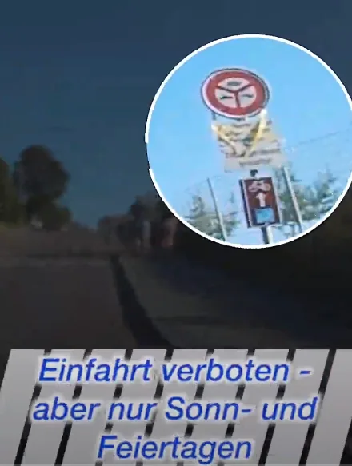

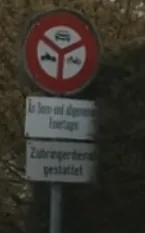

- **Kilchberg 沿湖路段三个极易漏看的 Right Priority**：

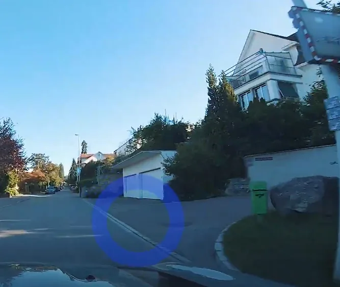

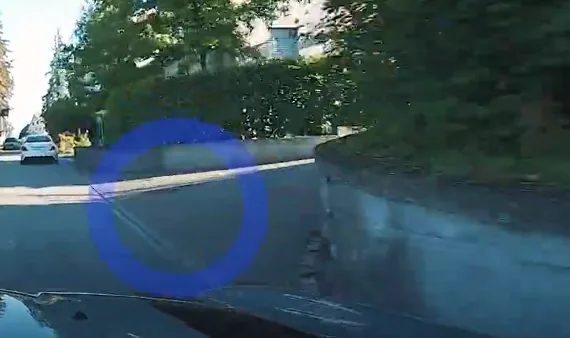

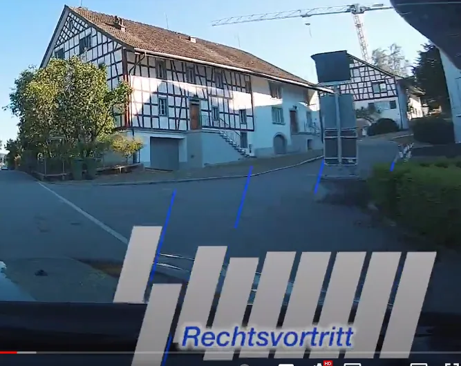

- 从 Thalwil / Rüschlikon 上 Autobahn，在 Wollishofen 下高速：**Wollishofen 这个路口直走需要打左转向灯**，并且在铁轨区域等待观察！

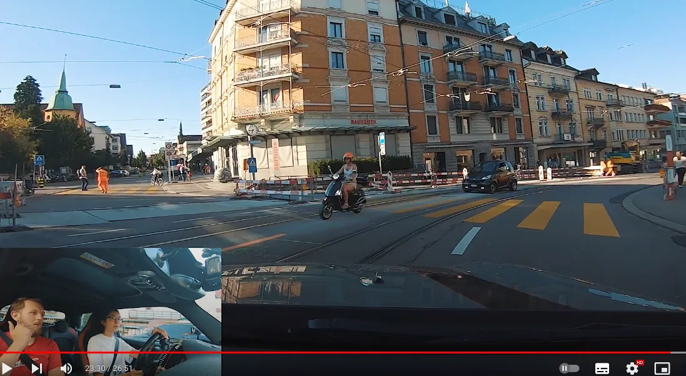

---

## 路线 4：Julien（Enge → Sihlcity → Thalwil → Lindt → Spital → Wollishofen → Enge）

**路线概览**：`Enge -> Sihlcity -> Autobahn (Chur) -> Thalwil -> Richtung Lindt -> Richtung Spital -> Wollishofen -> Enge`

### Teil 1

<iframe src="https://www.youtube.com/embed/xr3CLnu5k-E" title="YouTube video player" style="width: 100%; height: 100%; border: 0;" allow="accelerometer; autoplay; clipboard-write; encrypted-media; gyroscope; picture-in-picture" loading="lazy" allowfullscreen></iframe>

- Enge → Sihlcity → 上 A3 高速（Chur 方向）：**在看到高速 80 标志之前，前面一直是限速 60**，千万别提前超速！

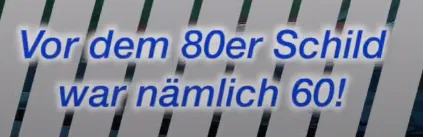

- Thalwil 下高速后，考官指令跟着 **Richtung Lindt** 路牌开（注意下高速后限速是 **60**）：

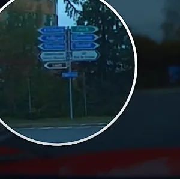

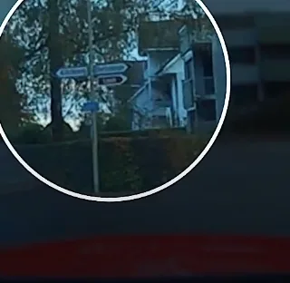

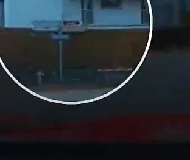

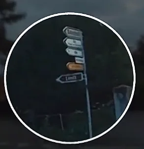

- **遇到临时施工红绿灯**：等待时间较长时记得关闭引擎（熄火环保要求）！

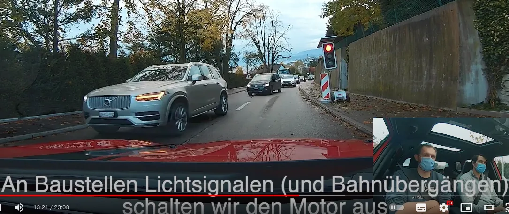

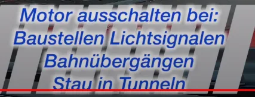

### Teil 2

<iframe src="https://www.youtube.com/embed/UcX6BjQD97s" title="YouTube video player" style="width: 100%; height: 100%; border: 0;" allow="accelerometer; autoplay; clipboard-write; encrypted-media; gyroscope; picture-in-picture" loading="lazy" allowfullscreen></iframe>

- **跟着 Richtung Spital 路牌开**（这一段考官最喜欢考“看路牌找路”，Spital 路牌经常藏在左侧栏杆或很远的位置）：
  - 在一个路口的**左边栏杆**上：

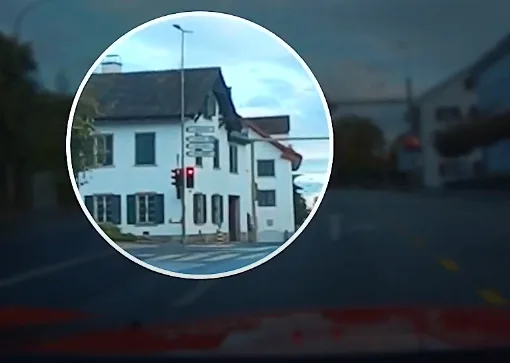

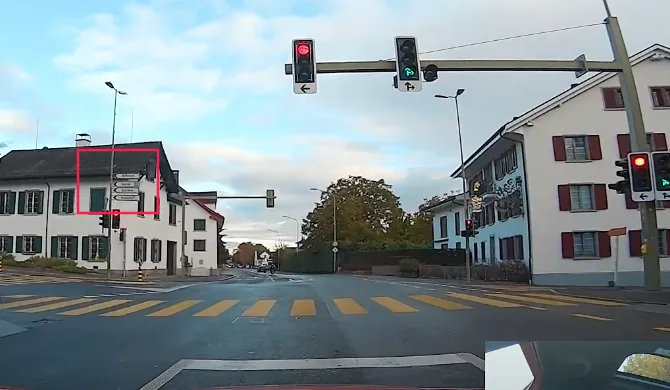

  - 在一个大路口的**左边栏杆**上：

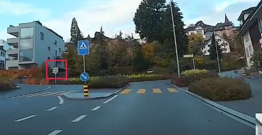

  - 在一个 Right of Way 的前头：

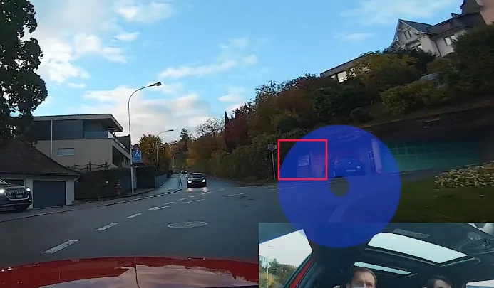

  - 在另一个路口前面老远的位置：

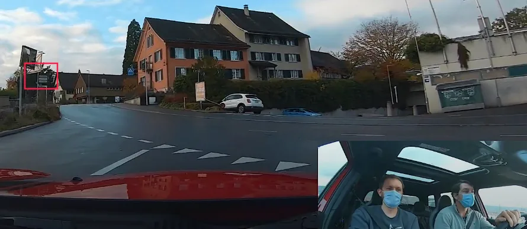

  - 过桥以后又在路左边的杆子上：

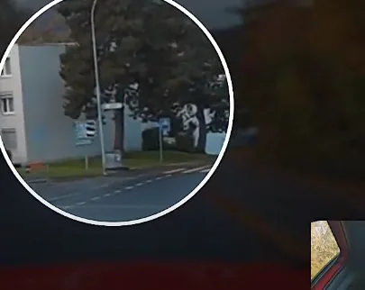

  - 最后还是在一个大路口的左边杆子上：

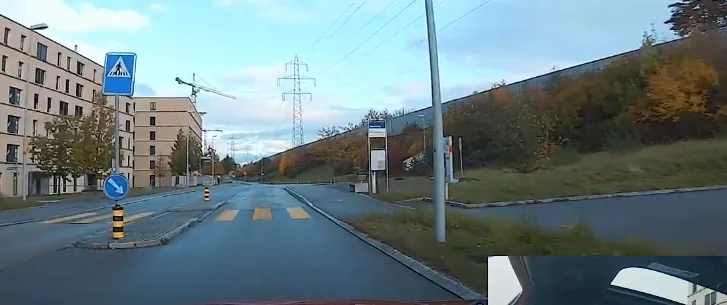

- **Kilchberg 前方右侧优先预警牌**：

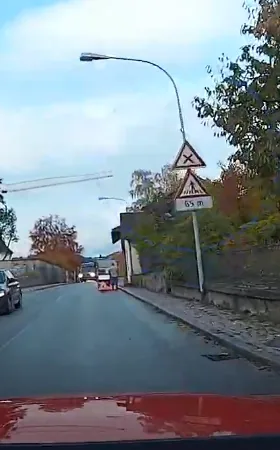

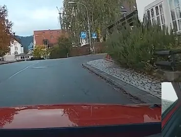

- **Wollishofen**：拐进小路做停车 + 掉头（Wenden），注意这里是超长 `30 Zone`；随后这个路口**直走需要打转向灯（Indicator）**，紧接着的 Right of Way 可以借助路边凸面镜观察，最后返回 Enge：

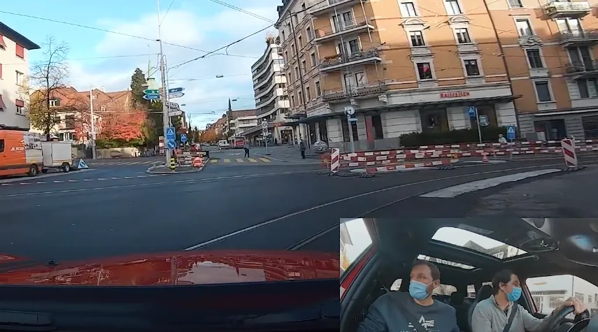

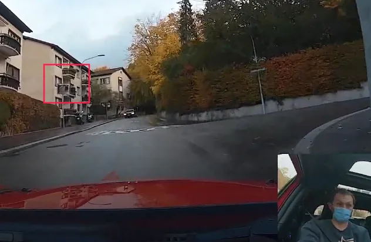

---

## 路线 5：Paul（STVA 右转 → Thalwil → Kilchberg → Wollishofen → 高速 → STVA）

**路线概览**：`STVA (R) -> Autobahn (Chur) -> Thalwil -> Kilchberg -> Wollishofen -> Autobahn -> Brunau -> STVA`

### Teil 1

<iframe src="https://www.youtube.com/embed/hUFdH8AvQr0" title="YouTube video player" style="width: 100%; height: 100%; border: 0;" allow="accelerometer; autoplay; clipboard-write; encrypted-media; gyroscope; picture-in-picture" loading="lazy" allowfullscreen></iframe>

- **避让公交车盲区**：左边有公交车停靠或慢行时千万不要盲目超车，公交车车头前方随时可能有人过人行横道，最好与公交车保持平行减速或拉开距离观察！

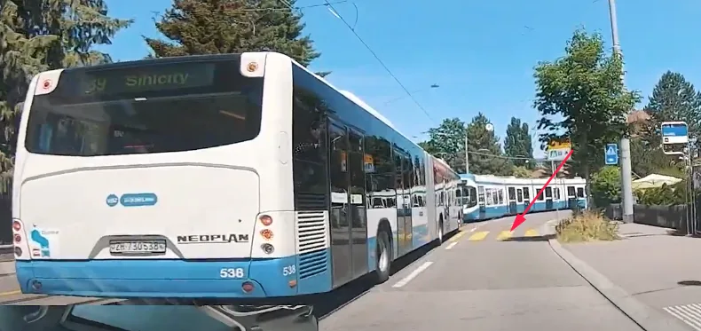

- **上高速（Chur 方向）**：这个分叉路口要稳稳保持在自己的车道（Spur）内：

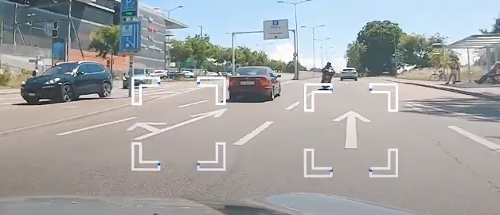

- **Thalwil → Kilchberg 超自行车**：超过自行车以后，**一定要先在内后视镜里完整看到自行车，再缓缓回到原车道**！

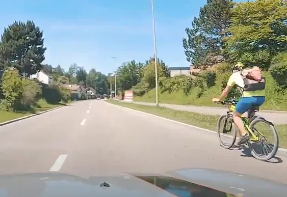

- **Kilchberg 刚进 30 Zone 的 Right Priority**：

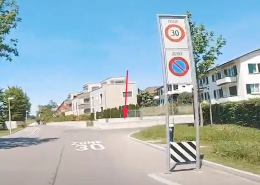

### Teil 2

<iframe src="https://www.youtube.com/embed/fUX-G6MN4pE" title="YouTube video player" style="width: 100%; height: 100%; border: 0;" allow="accelerometer; autoplay; clipboard-write; encrypted-media; gyroscope; picture-in-picture" loading="lazy" allowfullscreen></iframe>

- **Kilchberg 窄路控速**：有些住宅区小路很窄且两侧有灌木丛挡住视线，即使不是 `30 Zone` 也千万不要开太快。
- **靠右再左拐**：这个地方左拐同样要从右侧出口位置再左拐：

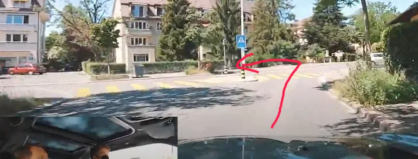

- **从 Wollishofen 上高速回 Zürich City**：

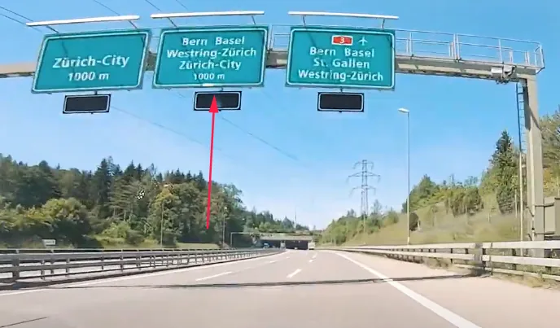

- **Brunau → STVA（Albisgütli）**：

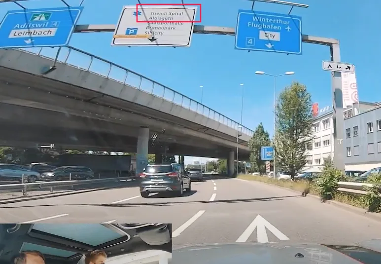

- **回 STVA 前的 Right Priority**：注意看地面标线，需要停在铁轨处礼让观察：

