Title: 瑞士学车记3.4 - 苏黎世 STVA 路考路线复盘：Sihltal 河谷片区（Leimbach / Adliswil / Langnau / Brunau）
Date: 2022-02-28
Tags: swiss
Slug: swiss-driving-test-3-4
Series: 瑞士学车记
Series_index: 6

本篇整理苏黎世驾校教练 [Nils Hommel](https://www.youtube.com/@NilsHommel) 频道中覆盖 **Sihltal 河谷片区**（Leimbach、Adliswil、Langnau、Brunau）的 3 套模拟路考视频复盘（共 6 段视频）。

这一片区最大的特点是 **Leimbach 超长 `30 Zone`、密集的 Right Priority、Adliswil 停车场与乡间窄路，以及 Brunau 附近的铁轨和斑马线禁区**。

---

## 路线 1：Jessica（STVA 左转 → Sihlcity → 高速 → Thalwil → Adliswil → Leimbach → Brunau）

**路线概览**：`STVA (L) -> Sihlcity -> Autobahn (Chur) -> Thalwil -> Adliswil -> Leimbach -> Brunau -> STVA`

### Teil 1

<iframe src="https://www.youtube.com/embed/VVt2oRJclFQ" title="YouTube video player" style="width: 100%; height: 100%; border: 0;" allow="accelerometer; autoplay; clipboard-write; encrypted-media; gyroscope; picture-in-picture" loading="lazy" allowfullscreen></iframe>

- 出考场左转（Left），紧接着左拐处注意 **Right of Way**：

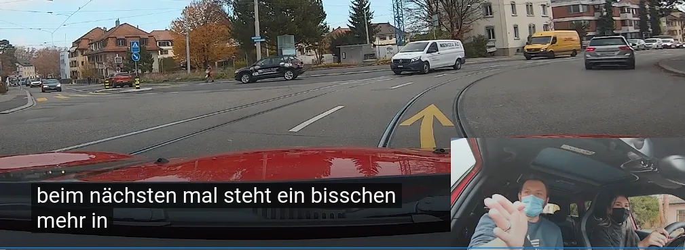

- **铁轨后面紧挨着的人行横道**（极易因为注意力在铁轨上而漏看行人）：

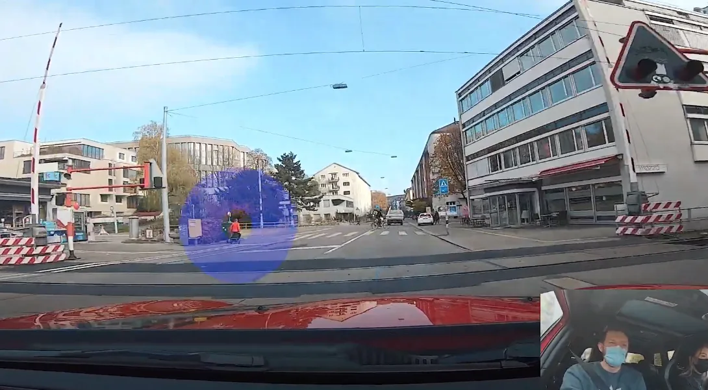

- **Sihlcity 路口**：

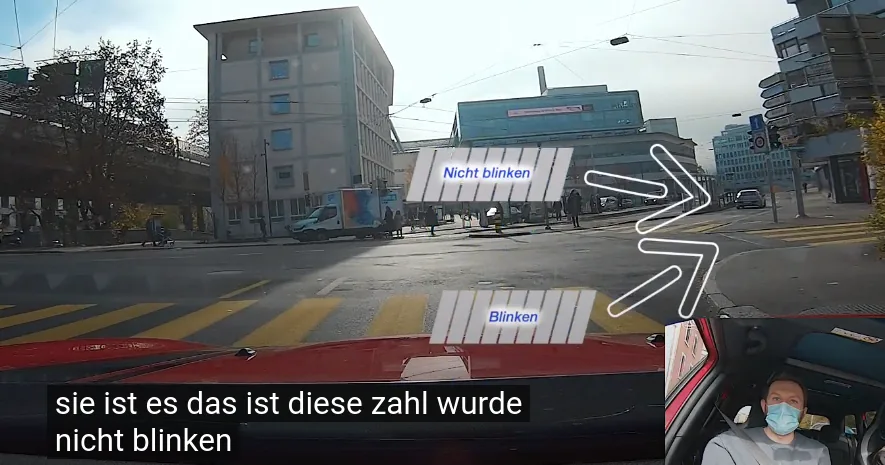

- **上高速（Chur 方向）**：
  - 考官没特别指示方向时，默认走最右侧行车道。
  - 如果并线变道空间不够、感觉困难，千万不要盲目猛踩油门硬挤（视频约 11:45 处）。
- **Thalwil → Lindt / Kilchberg → Adliswil**：拐进小道前往 Adliswil 停车场方向做路边停车，注意这里的 **Right of Way**，随后进入 Adliswil 市区：

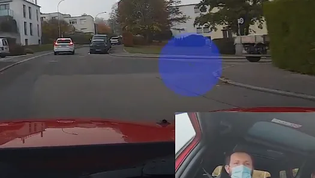

### Teil 2

<iframe src="https://www.youtube.com/embed/Az4WRqL-Znk" title="YouTube video player" style="width: 100%; height: 100%; border: 0;" allow="accelerometer; autoplay; clipboard-write; encrypted-media; gyroscope; picture-in-picture" loading="lazy" allowfullscreen></iframe>

- 过了转盘往 **Felsenweg** 方向开：

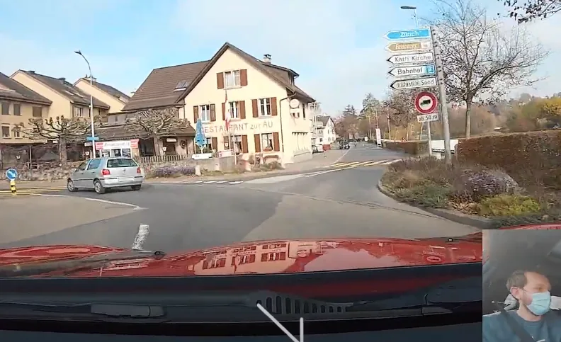

- 窄路对面迎面开来公交车时，必要情况下可以稍微借用一下路边人行道低速礼让：

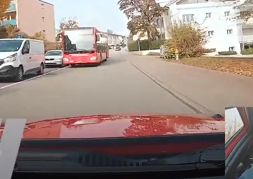

- **进入 Leimbach（超长 30 Zone）**，注意沿途的 Right of Way：

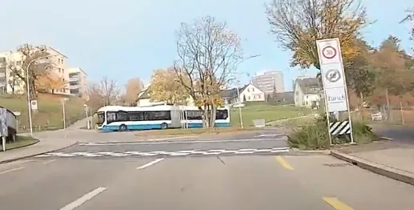

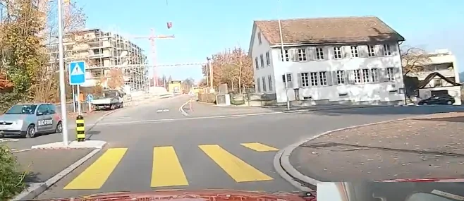

- **返回苏黎世市区**：

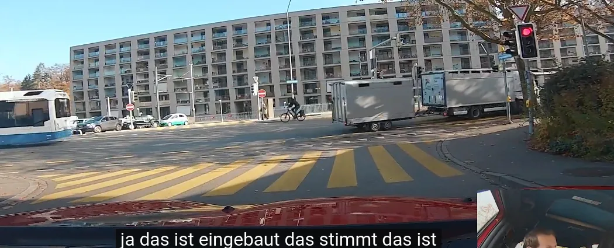

- **超大路口绿箭头**：这里是独立箭头绿灯（Arrow），按信号指示通行不用等对向或冲突方向行人：

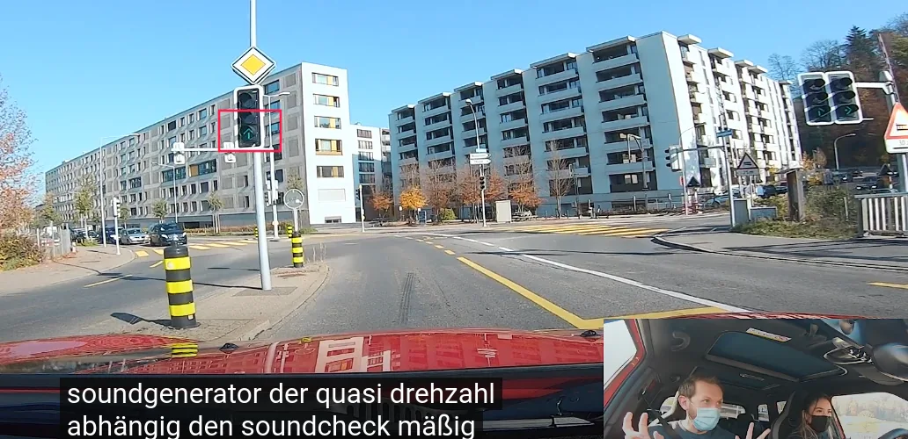

- 之后沿着平行高速的 `60` 限速路开回 Brunau 路口，再返回 STVA（视频中因为忘记提前变道，只能在 Sihlcity 绕了一圈再回来——提醒我们路线走错不要慌，顺着合法路线绕回来即可，千万别违规实线变道）。

---

## 路线 2：Kyra（Enge → 苏黎世市区 → Kilchberg → Adliswil → Wollishofen → Brunau）

**路线概览**：`Enge -> Zürich City -> Kilchberg -> Adliswil -> Wollishofen -> Autobahn -> Brunau`

### Teil 1

<iframe src="https://www.youtube.com/embed/--4p3uhAKU8" title="YouTube video player" style="width: 100%; height: 100%; border: 0;" allow="accelerometer; autoplay; clipboard-write; encrypted-media; gyroscope; picture-in-picture" loading="lazy" allowfullscreen></iframe>

- 从 Enge 出发往市区火车站方向开，经过一段左侧紧贴 Tram 的路段。
- **距离提示禁止通行牌**：注意下面的辅助牌，表示 **240 m 以后**禁止通行（当前路口仍可开入）：

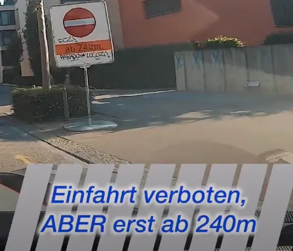

- **借道左拐**：这里左拐时需要按地面标线借用 Bus 车道：

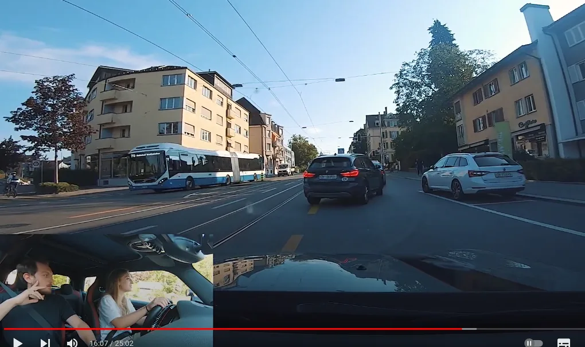

- 遇到前方公交车倒车时耐心拉开距离等待：

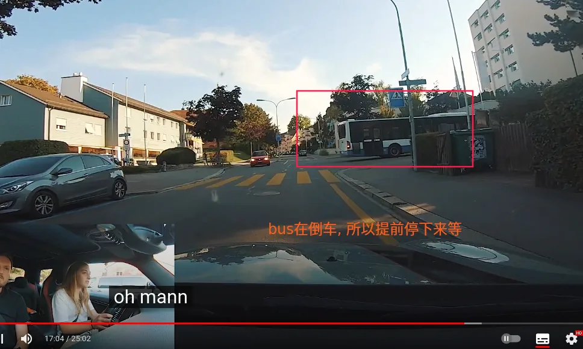

- **这个路口不是 Right of Way**（因为右侧是单行道出口反方向，不会有车开出来）：

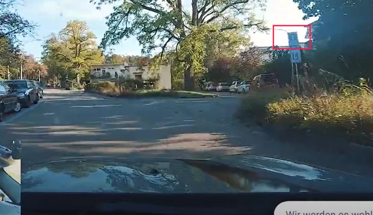

- **一个极不容易看见的 Right of Way**：

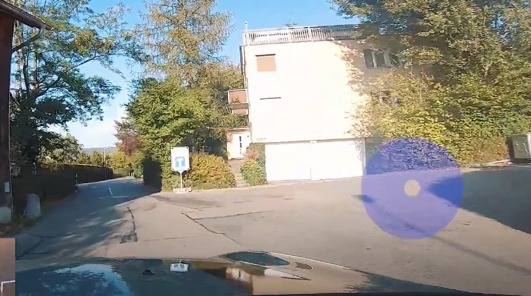

- 随后从小路一路开往 Kilchberg。

### Teil 2

<iframe src="https://www.youtube.com/embed/jXaCEaql2CQ" title="YouTube video player" style="width: 100%; height: 100%; border: 0;" allow="accelerometer; autoplay; clipboard-write; encrypted-media; gyroscope; picture-in-picture" loading="lazy" allowfullscreen></iframe>

- Kilchberg 沿湖向南开 → Adliswil 停车场 → 从小路开往 Wollishofen 方向 → 从 Wollishofen 上高速。
- **Brunau 路口右拐**：千万**不要压到白色斜线导流区（Sperrfläche）**！

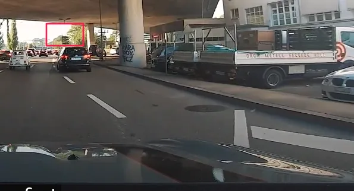

- **铁轨前确认路况**：前方有铁轨时，一定要先确认铁轨对面不堵车、有足够空间容下整台车再开过去！

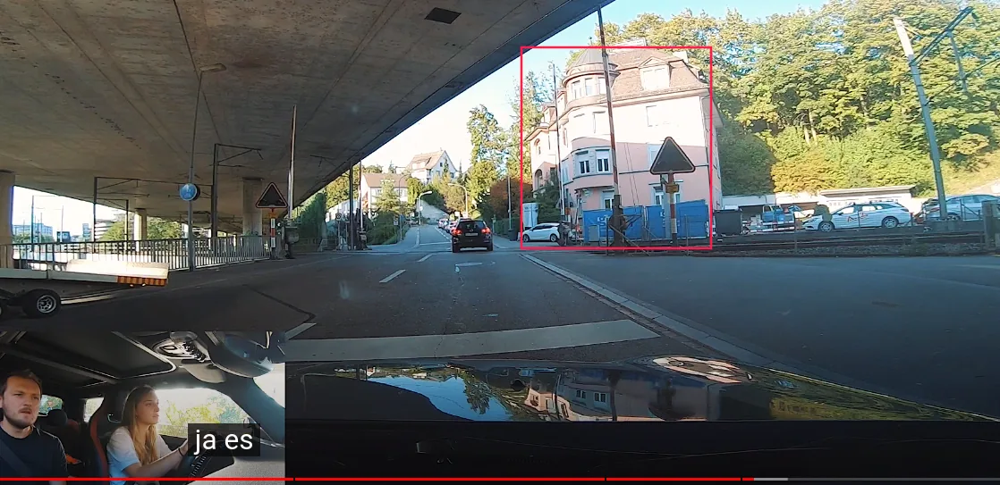

- 之后经过一些单行道返回考场片区。

---

## 路线 3：Lena（STVA 右转 → Leimbach → Adliswil → Langnau → Thalwil 上高速 → Brunau → STVA）

**路线概览**：`STVA (R) -> Leimbach -> Adliswil -> Langnau -> Gattikon -> Thalwil Autobahn -> Brunau -> Sihlcity -> STVA`

### Teil 1

<iframe src="https://www.youtube.com/embed/bYmhOj3jSiA" title="YouTube video player" style="width: 100%; height: 100%; border: 0;" allow="accelerometer; autoplay; clipboard-write; encrypted-media; gyroscope; picture-in-picture" loading="lazy" allowfullscreen></iframe>

- 出考场右转（Rechts），沿 `60` 限速路往 Luzern 方向开。
- Leimbach 附近做停车与掉头（Wenden），牢记 Leimbach 超长的 `30 Zone`。
- **Adliswil 市区**：在 Adliswil 内部绕行了很久，注意沿途的 Right Priority：

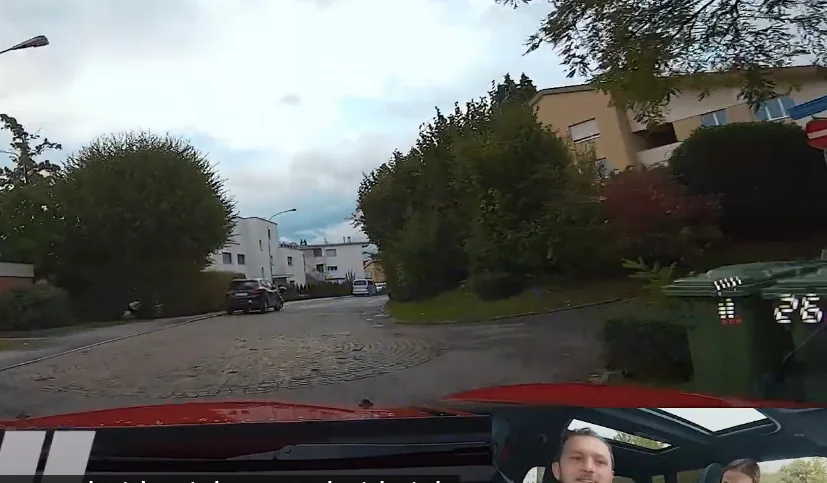

- 随后驶入乡间公路开往 **Langnau**：

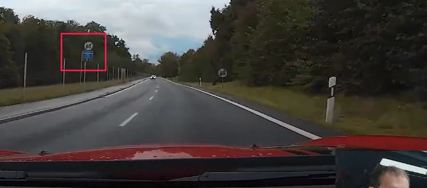

### Teil 2

<iframe src="https://www.youtube.com/embed/3ovG8VKQhuE" title="YouTube video player" style="width: 100%; height: 100%; border: 0;" allow="accelerometer; autoplay; clipboard-write; encrypted-media; gyroscope; picture-in-picture" loading="lazy" allowfullscreen></iframe>

- 从 Langnau 开到 Gattikon 附近的 Lidl 一带，再从 Thalwil 上高速。
- **Brunau（下高速后右拐）**：

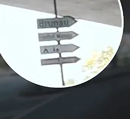

- **铁路道口**：栏杆抬起后，务必等到**红灯完全熄灭**再起步通过！

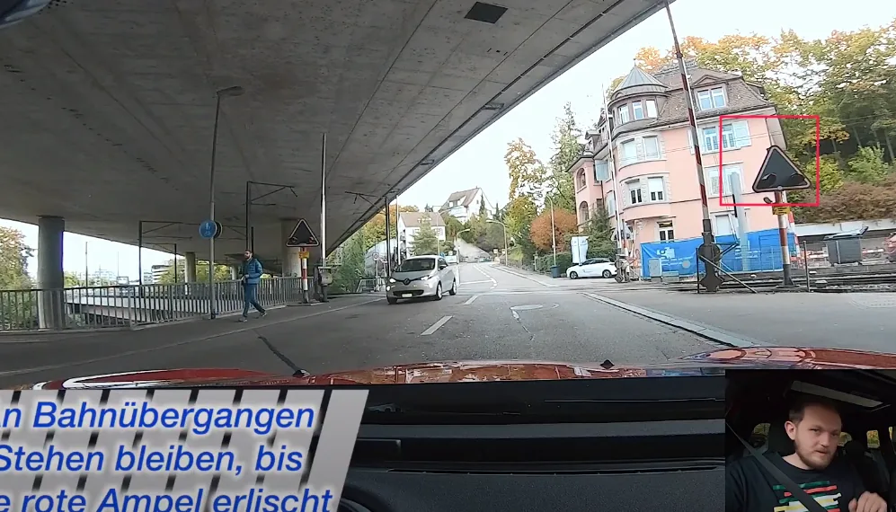

- **过铁轨后的超长隐蔽 30 Zone**：这段路右侧画着自行车道，很容易让人误以为是 `50` 的主干道，其实全段都是 **`30 Zone`**——开上去很久才会在地面看到 `30` 喷漆，千万别超速！

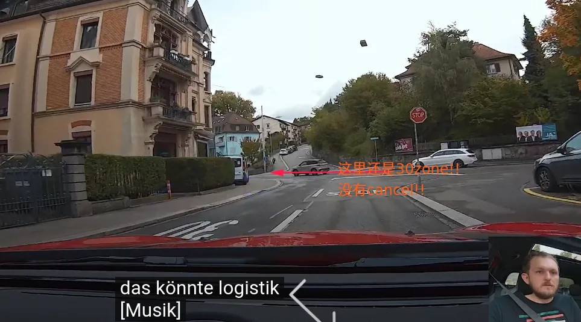

- 最后经 Sihlcity 返回 STVA。
