Title: 瑞士学车记3.5 - 苏黎世 STVA 路考路线复盘：西线山区与市中心片区（Birmensdorf / Uitikon / Wettswil / Zoo）
Date: 2022-02-27
Tags: swiss
Slug: swiss-driving-test-3-5
Series: 瑞士学车记
Series_index: 7

本篇是考前模拟路线复盘的最后一篇，整理苏黎世驾校教练 [Nils Hommel](https://www.youtube.com/@NilsHommel) 频道中覆盖**西线山区（Birmensdorf / Uitikon / Wettswil / Triemli / Altstetten）**以及**苏黎世市中心（Wiedikon / Hardplatz / Zoo / 金岸 / Central）**的 3 套模拟路考视频复盘（共 6 段视频）。

西线山区以 **Uitikon 石头柱子 + 密集 Right Priority** 闻名，而市中心路线则极度考验**看路牌找方向（Richtung Zoo）**、**复杂 Tram 路口观察**以及**单行/禁行识别**。

---

## 路线 1：Delia（STVA 右转 → Sporthalle → Birmensdorf → Uitikon → Altstetten → STVA）

**路线概览**：`STVA (R) -> Sporthalle -> Autobahn (Bern/Basel) -> Birmensdorf -> Landikon -> Uitikon -> Triemli -> Altstetten -> STVA`

### Teil 1

<iframe src="https://www.youtube.com/embed/ET7zsWoR0bY" title="YouTube video player" style="width: 100%; height: 100%; border: 0;" allow="accelerometer; autoplay; clipboard-write; encrypted-media; gyroscope; picture-in-picture" loading="lazy" allowfullscreen></iframe>

- **Sporthalle**：过了绿灯就要立刻右拐，提前做好准备：

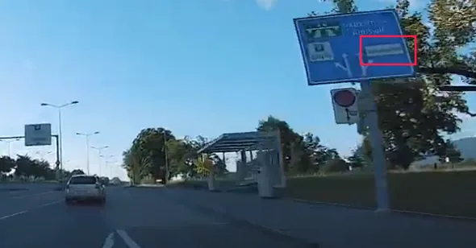

- **高速 Bern / Basel 方向**：隧道里有两条车道都通往 Bern / Basel，按靠右行驶原则需要**并入右侧车道**！

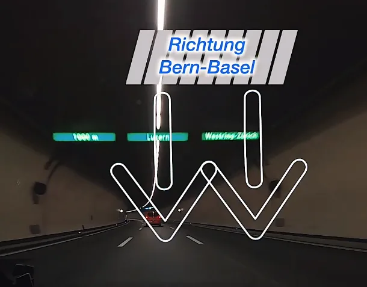

- **Birmensdorf 出口**：下高速出来时要变到右侧车道，务必扭头看右侧车窗盲区！

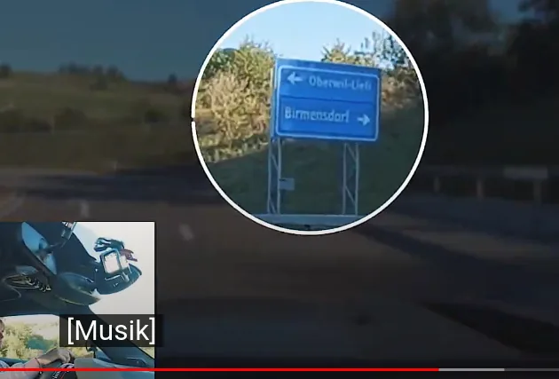

- **Birmensdorf 连续 Right Priority 陷阱**：
  - 刚拐进去就有一个 Right Priority：

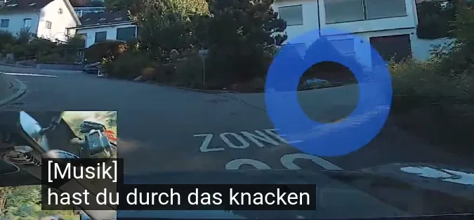

  - 教堂旁边紧接着有**两个带石墩的 Right Priority**！

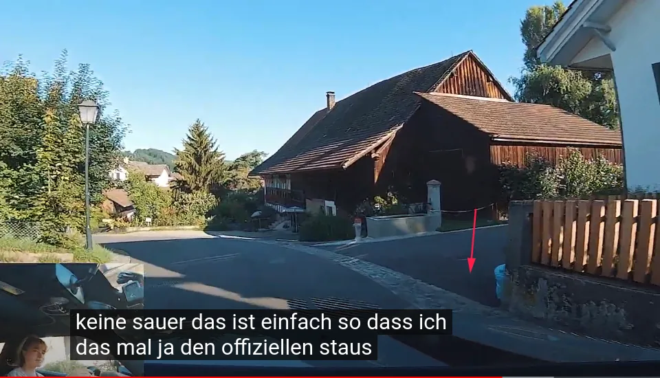

  - 这里的路障柱子非常隐蔽，一不留神会以为前面还能直行：

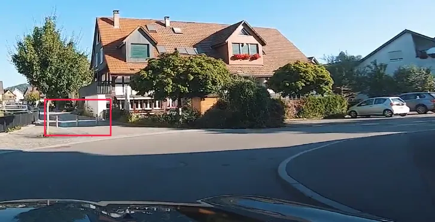

  - 刚取消 `30 Zone` 不久，又紧跟着一个极易忽视的 Right Priority：

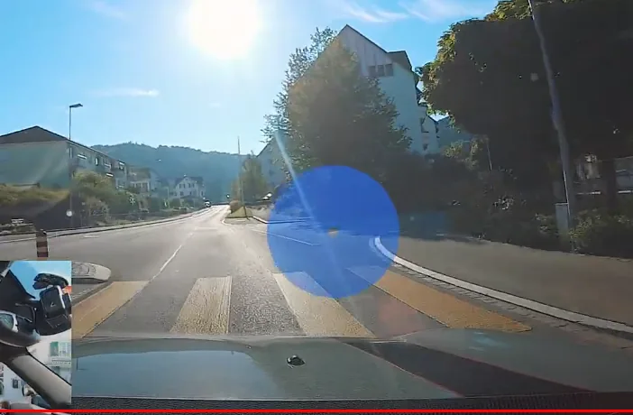

- **Landikon**：过这个窄桥洞之前，最好减速仔细观察对向来车：

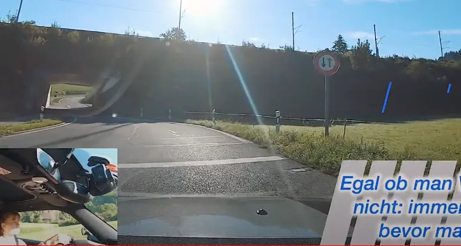

- **Uitikon 转盘**：注意这个环岛出口有两个方向牌箭头，要去的是**第二个出口**！

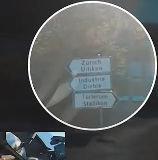

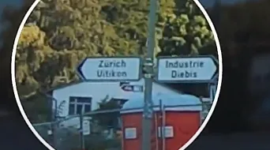

### Teil 2

<iframe src="https://www.youtube.com/embed/hY5O2ZO_L2c" title="YouTube video player" style="width: 100%; height: 100%; border: 0;" allow="accelerometer; autoplay; clipboard-write; encrypted-media; gyroscope; picture-in-picture" loading="lazy" allowfullscreen></iframe>

- **Uitikon**：又一个 Right Priority：

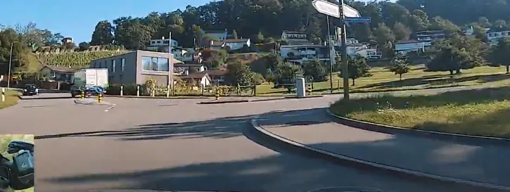

- **从 Uitikon 下山回苏黎世（Triemli 附近路口）**，随后经 Altstetten 返回 STVA：

---

## 路线 2：Nina（Triemli → Altstetten → Uitikon → Birmensdorf → Wettswil → 高速 → Brunau → STVA）

**路线概览**：`STVA -> Triemli -> Altstetten -> Uitikon -> Birmensdorf -> Wettswil -> Autobahn (Chur) -> Brunau -> Zürich -> Sihlcity -> STVA`

### Teil 1

<iframe src="https://www.youtube.com/embed/vUNc7lUEeV4" title="YouTube video player" style="width: 100%; height: 100%; border: 0;" allow="accelerometer; autoplay; clipboard-write; encrypted-media; gyroscope; picture-in-picture" loading="lazy" allowfullscreen></iframe>

- **出考场停车场就直接左拐**，前往 **Spital Triemli**：
  - 经过一个带铁轨的较大路口：

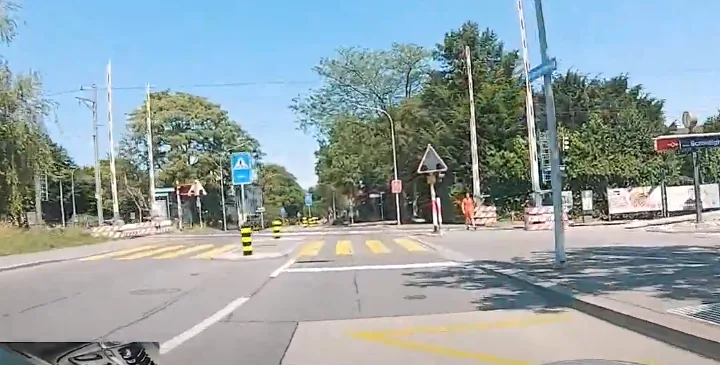

  - 紧接着大路口左拐：同时盯紧对向直行车和过街行人！

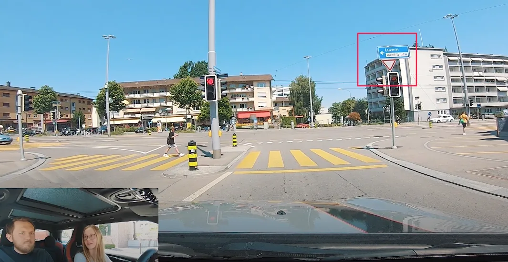

- **Altstetten**：同方向有两条车道时，默认**走右侧车道**！

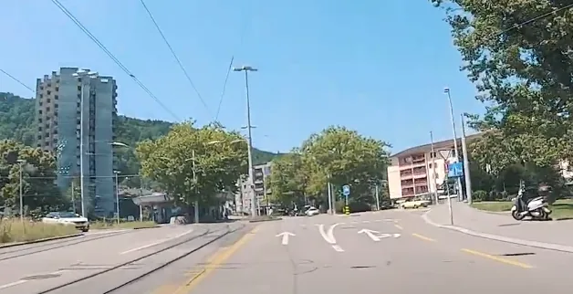

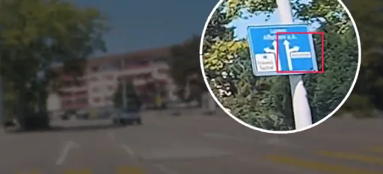

- **往 Luzern 方向爬坡路段**：
  - 注意沿途的 Right Priority：

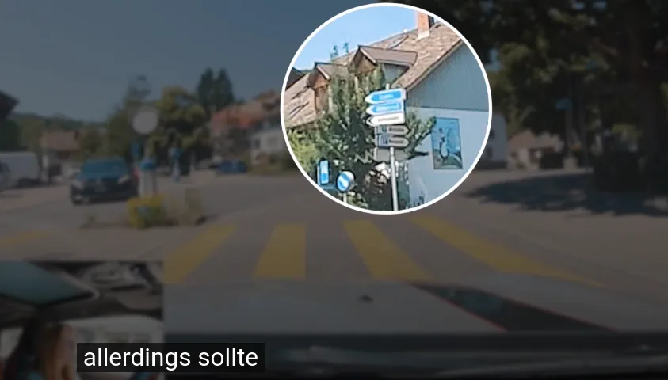

  - **出了 30 Zone 以后路面较窄**：需要借用右侧虚线自行车道（右边两个轮子压在自行车道内行驶）：

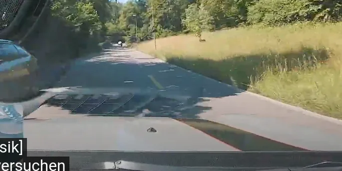

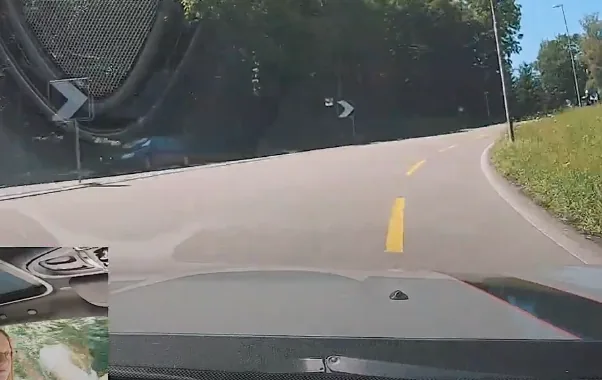

  - **但到了路口处必须给自行车（Velo）让出空间**：

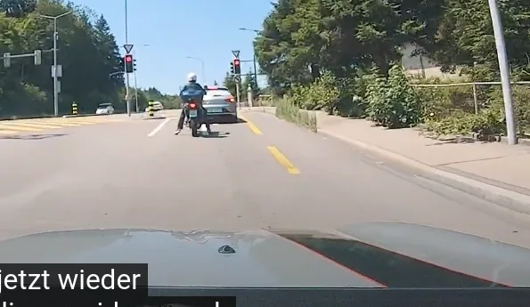

  - 在黄色虚线处拐进停车场：

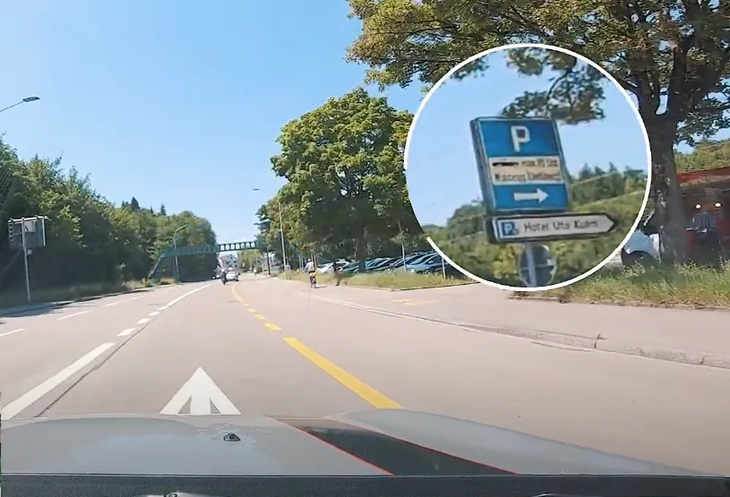

- **Uitikon 密集桩子 + 连续 Right Priority 路口**：

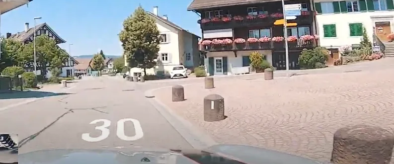

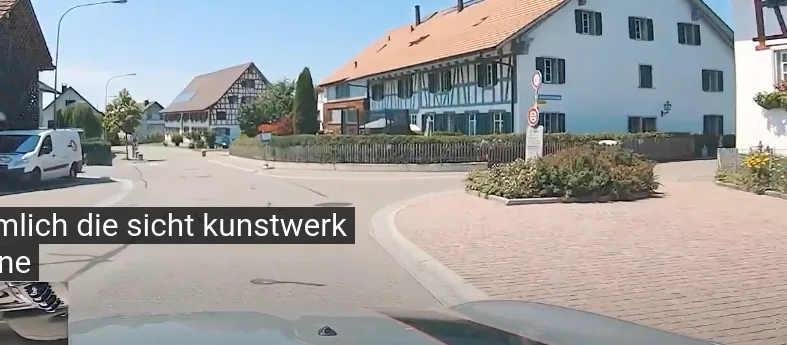

  - **经典连环坑**：`30 Zone 取消` 牌子和 `Right Priority` 刚好紧挨在一起！

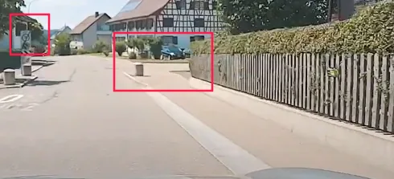

  - 最后连续两个 Right Priority：

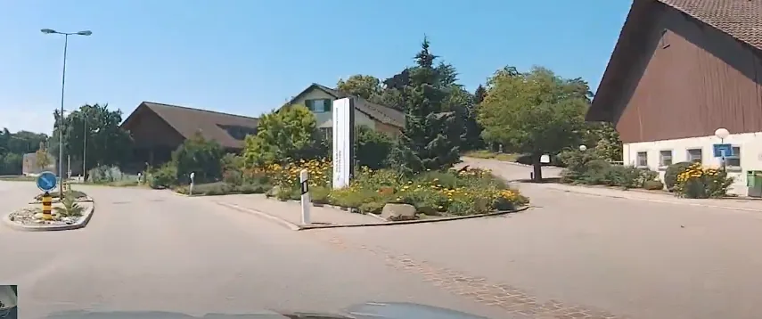

- 随后沿 Luzern 方向往回开：

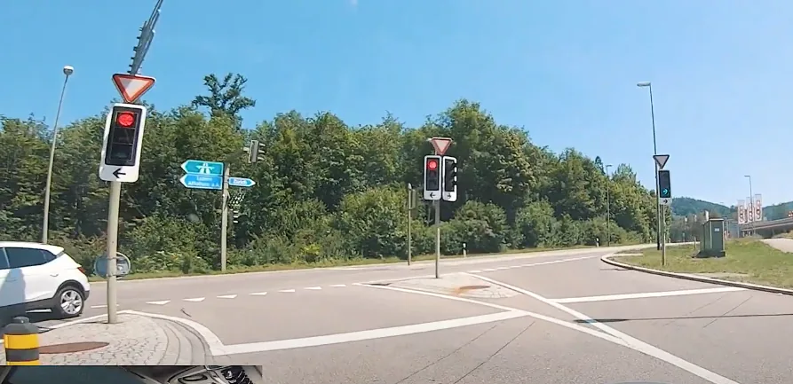

### Teil 2

<iframe src="https://www.youtube.com/embed/CnUvnMAGvrM" title="YouTube video player" style="width: 100%; height: 100%; border: 0;" allow="accelerometer; autoplay; clipboard-write; encrypted-media; gyroscope; picture-in-picture" loading="lazy" allowfullscreen></iframe>

- 开到 Birmensdorf 后往 **Wettswil** 开：**前方第二个红绿灯路口才是 Wettswil**，不要在第一个牌子处拐错！
  - 第一个路牌：

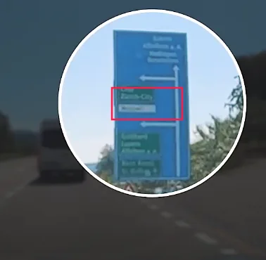

  - 第二个路牌：

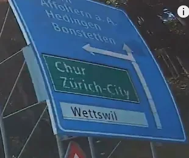

- **上 Autobahn（Chur 方向）**：从 Wettswil 上高速后需要主动变道一次：

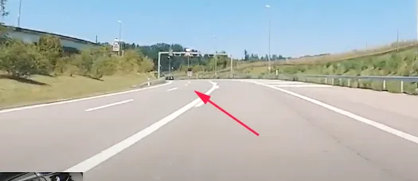

- 最后从 Brunau 下高速，在苏黎世市区绕行一小段，经 Sihlcity 返回 STVA。

---

## 路线 3：Dardan（Enge → Wiedikon → Hardplatz → Zoo → 金岸 → Central → Enge）

**路线概览**：`Enge -> Wiedikon -> Albisriederplatz -> Hardplatz -> Richtung Zoo -> 金岸 -> Central / Bellevue -> Enge`

### Teil 1

<iframe src="https://www.youtube.com/embed/Y8G-An-UaY4" title="YouTube video player" style="width: 100%; height: 100%; border: 0;" allow="accelerometer; autoplay; clipboard-write; encrypted-media; gyroscope; picture-in-picture" loading="lazy" allowfullscreen></iframe>

- 从 Enge 车站拐进一个小隧道（通往高速方向）：

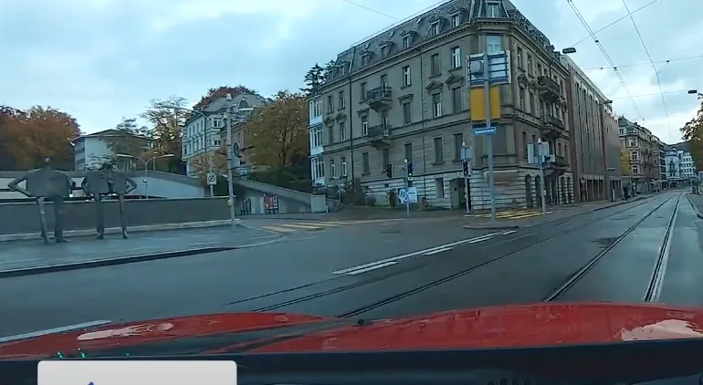

- 右拐往 Wiedikon 车站方向，注意**右拐是单独的绿灯**：

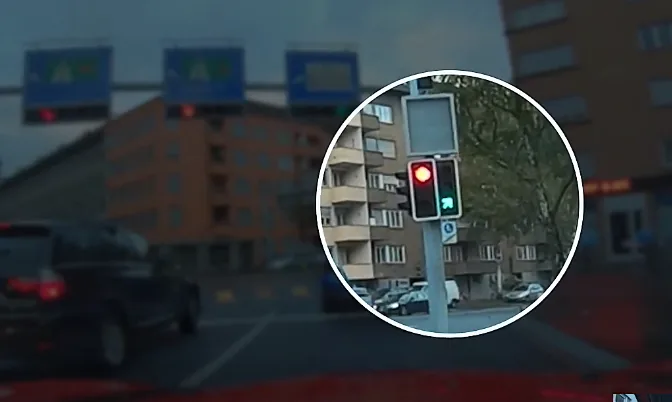

- **核心考点：跟着「Richtung Zoo」路牌穿越市区**（非常考验提前识牌选道）：
  - Albisriederplatz 环岛/大路口处：

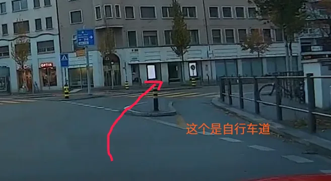

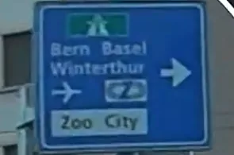

  - Prime Tower 旁边的路牌：

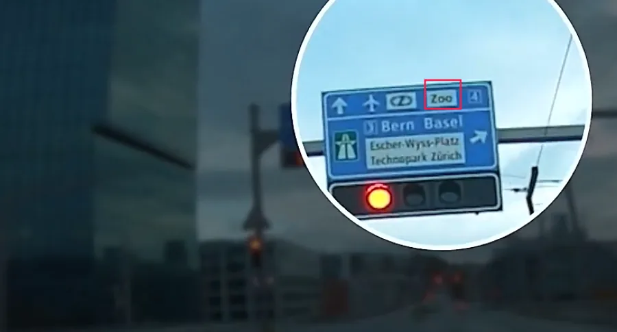

  - 下桥走一段才出现下一个路牌：

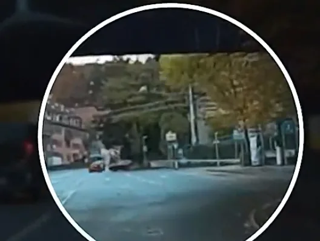

  - 路牌挂在路口另一侧：

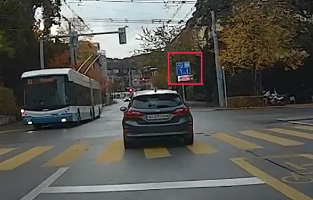

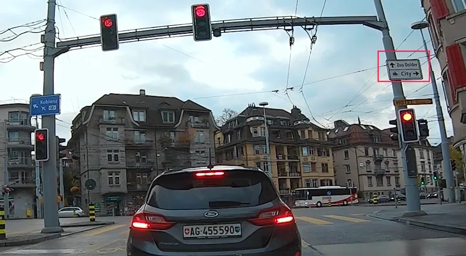

  - 沿途连续路口与选道点位：

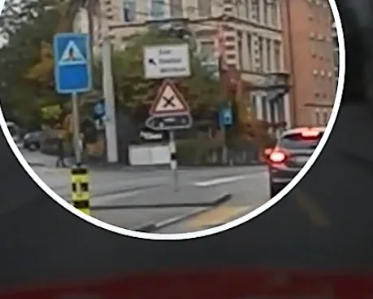

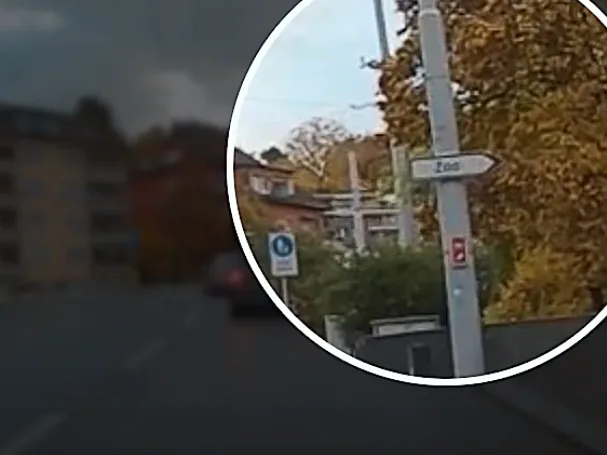

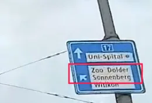

  - **超高难度左拐路口**：这个路口左拐必须同时观察三个方向（对向车、Tram、行人）！

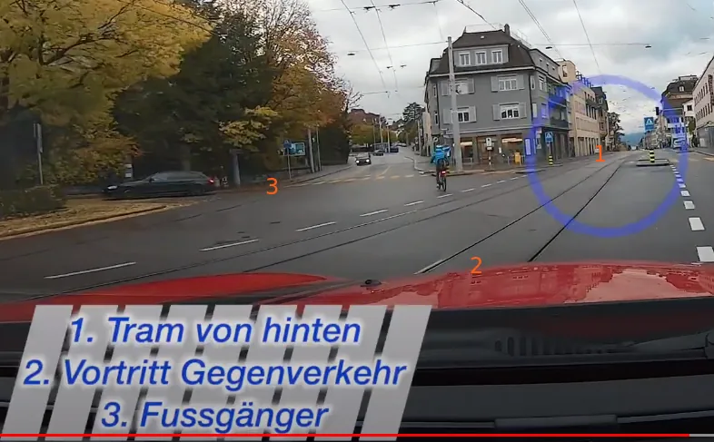

  - 继续沿指示牌前进（之后需要沿着 Tram 轨道开好长一段）：

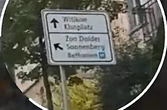

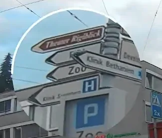

### Teil 2

<iframe src="https://www.youtube.com/embed/lNJq7BsKNWg" title="YouTube video player" style="width: 100%; height: 100%; border: 0;" allow="accelerometer; autoplay; clipboard-write; encrypted-media; gyroscope; picture-in-picture" loading="lazy" allowfullscreen></iframe>

- 从 Zoo 出来一路下山开到湖东金岸一带，注意这处**禁止通行**标志：

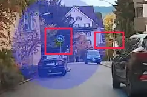

- 从金岸开往 Central / Bellevue 返回 Enge，途中又有一处容易误闯的**禁止通行**：

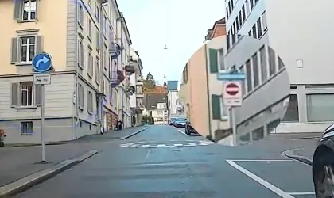

---

以上就是当年在苏黎世考驾照的全部笔记整理。如果你也在备考苏黎世 STVA 路考，建议考前结合 Google Maps 街景和 Nils Hommel 的模拟视频多“云跑”几遍高频路段，祝一次通过！
