Title: 瑞士学车记4 - 拿照实战：沿湖 Seestrasse 往返苏黎世大学医院（USZ）路线记录
Date: 2023-02-12
Tags: swiss
Slug: swiss-driving-test-4
Series: 瑞士学车记
Series_index: 8

拿到驾照后真正自己上路，穿过苏黎世市中心（Bellevue / Central / HB / ETH / USZ）依然是个不小的挑战——车道频繁切换、Tram 轨道纵横交错、行人密度极高。

这篇记录的是 2023 年 2 月我从苏黎世湖西岸（Oberrieden 一带）出发，沿 **Seestrasse** 开往 **苏黎世大学医院（USZ）**，再经 **ETH → Central → 苏黎世主火车站（HB）→ Europaallee → Enge** 上高速返程的完整踩点笔记，单程大约 30 分钟。

---

## 1. 去程：沿 Seestrasse 开往 USZ

- 从 Oberrieden 汇入 **Seestrasse**：

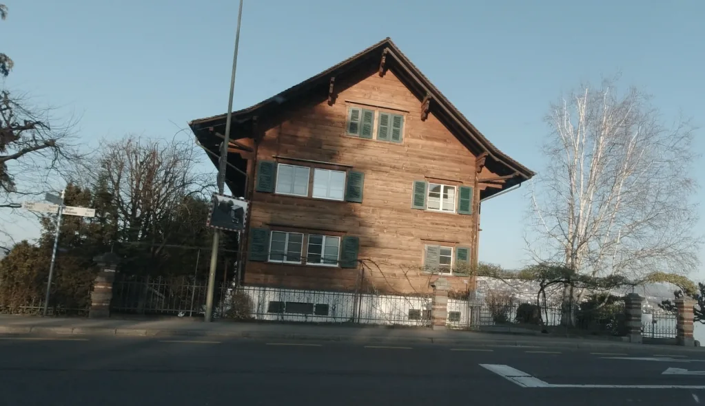

- 注意 Seestrasse 沿湖路段过马路的行人比较多，时刻留意人行横道：

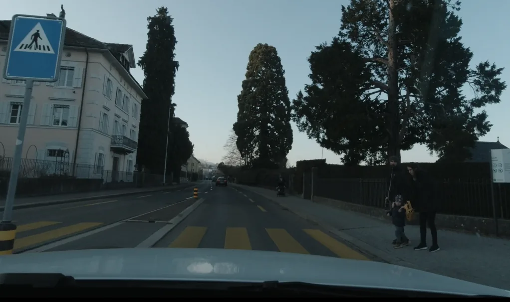

- 沿着湖边开约 7 km 进入苏黎世市区（Wollishofen）：

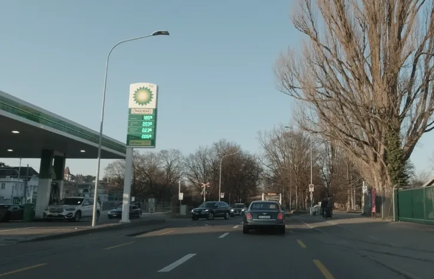

- 保持直行，进城后人行横道开始密集，注意减速观察：

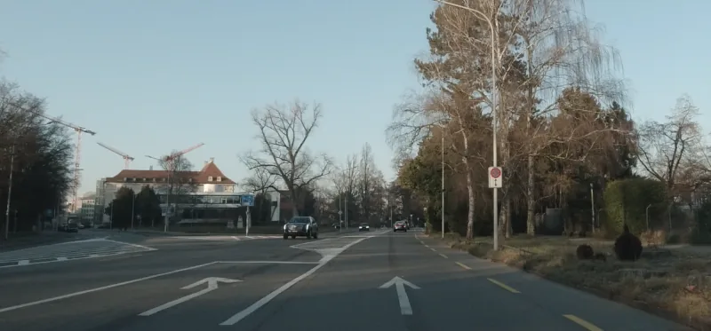

- **这个红绿灯路口选中间车道**：

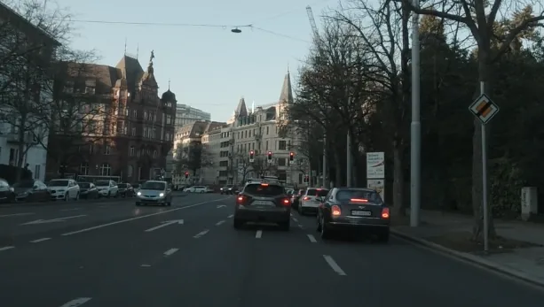

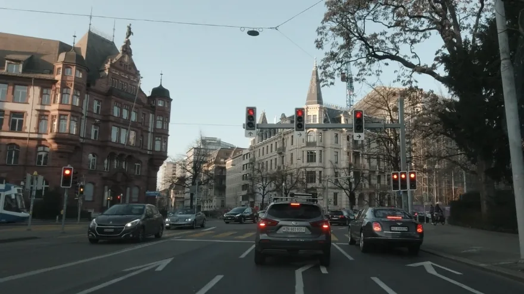

- 贴着 Tram 轨道旁边开、准备过桥，依旧保持在**左侧车道**：

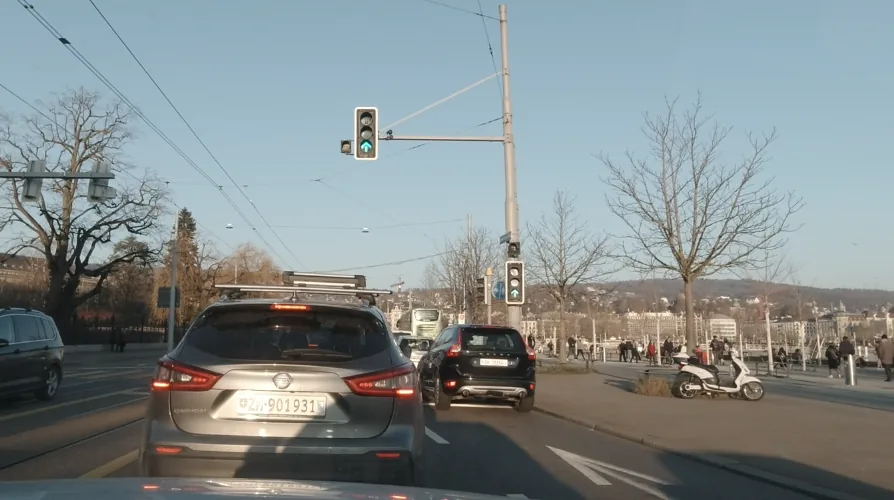

- Tram 旁边这里其实分成了两条车道，选**中间直行车道**直接上桥即可：

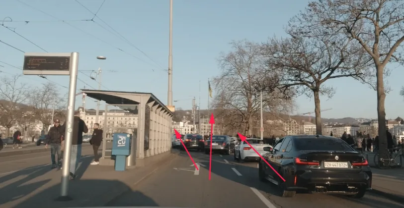

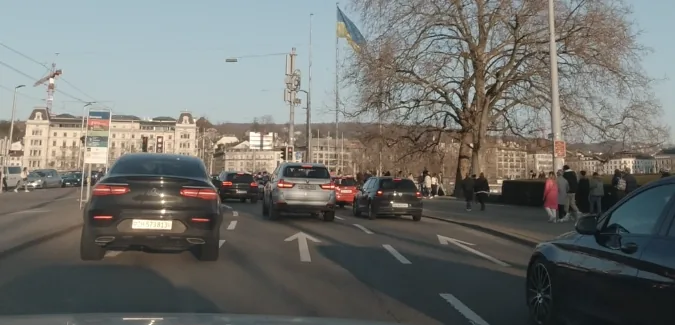

- **过桥以后选左边第二车道左拐**：

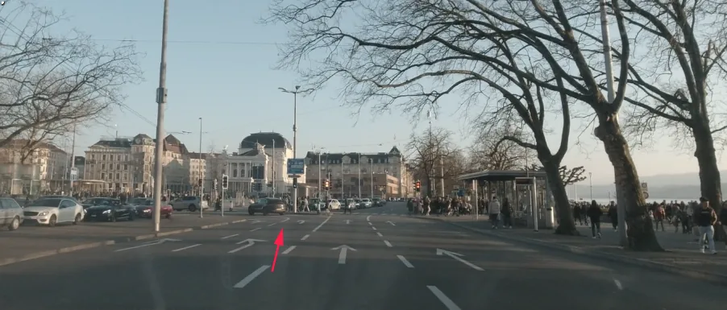

- 左拐以后紧接着右拐——**这里行人超级多**，务必慢速逐个礼让！

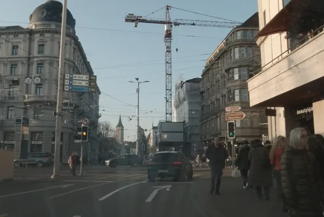

- 之后直行上坡，注意左侧并行的 Tram：

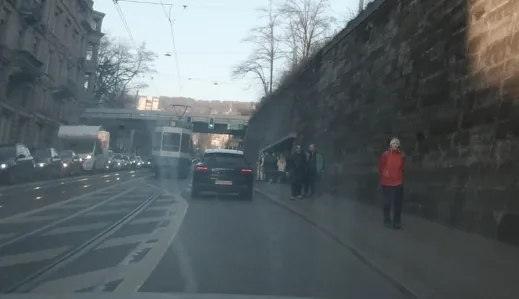

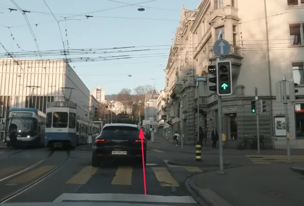

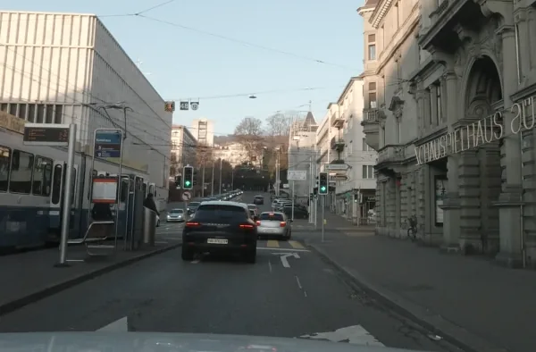

- **无红绿灯复杂路口**：这个路口直行时感觉需要打转向灯提示，而且要注意**礼让右侧优先（Right Priority）**，同时盯紧左侧开过来的 Tram！

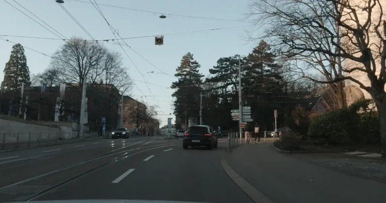

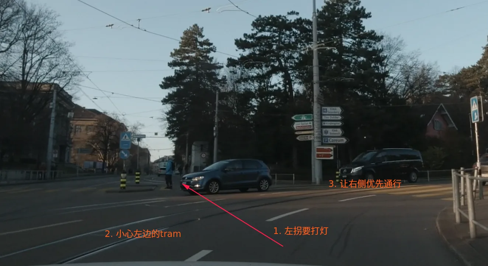

- 之后从 ETH 主楼前面开过去就到达 USZ 了——**ETH 门口横穿马路的学生和行人非常多，务必放慢车速！**

---

## 2. 返程：经 ETH / Central / HB 上高速回湖西岸

- 从 USZ 出来，在 **ETH 的 6 路电车站** 附近开始下山，**多注意连续的人行横道**！

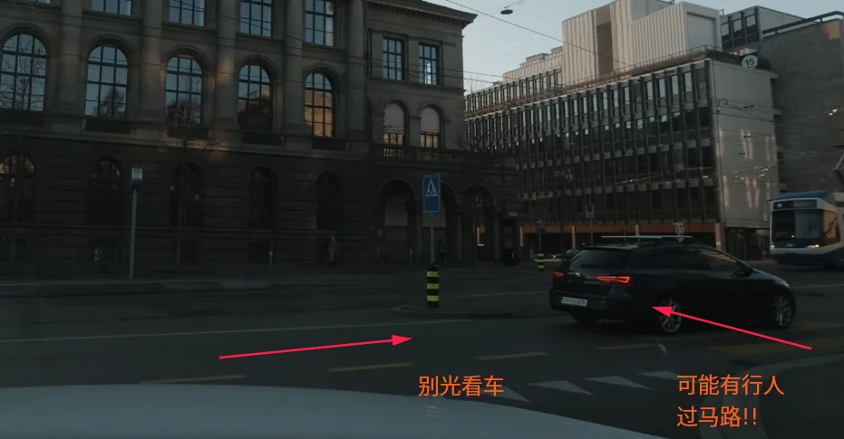

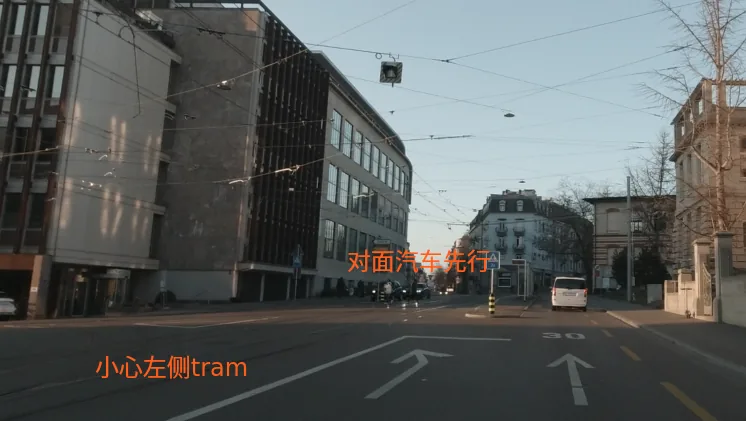

- 沿着 Tram 轨道的路线一路下山：

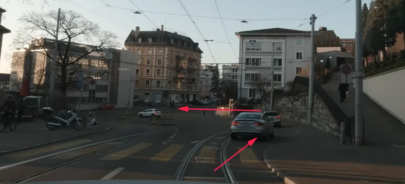

- 这个转弯口要小心右侧来车：

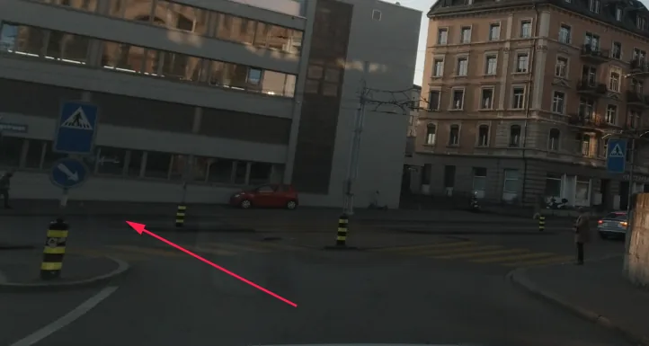

- 拐过去以后走**右侧车道**（左侧是 Tram 轨道）：

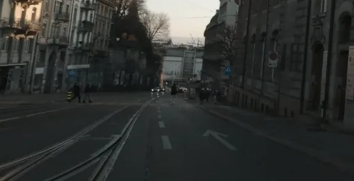

- 经过 **Central** 开往苏黎世主火车站（HB）门口——**Central 行人同样超级多，千万小心！**

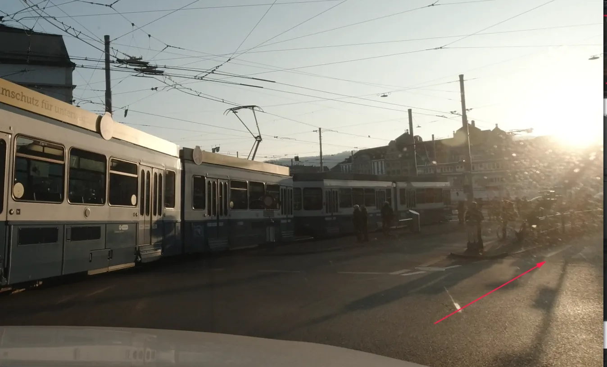

- 上桥的时候提前选好**左侧车道**：

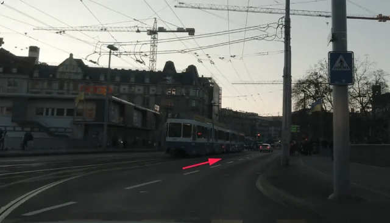

- 经过 HB 门口时也一直保持在**左侧车道**：

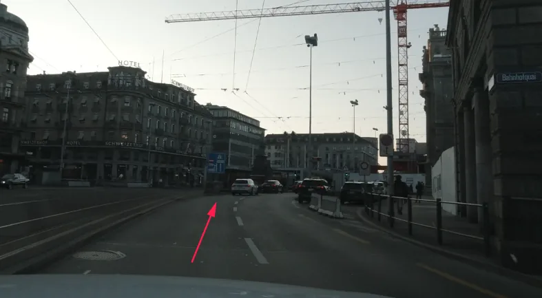

- 沿 **Europaallee** 一侧开往 Enge 方向，继续走**左侧车道**：

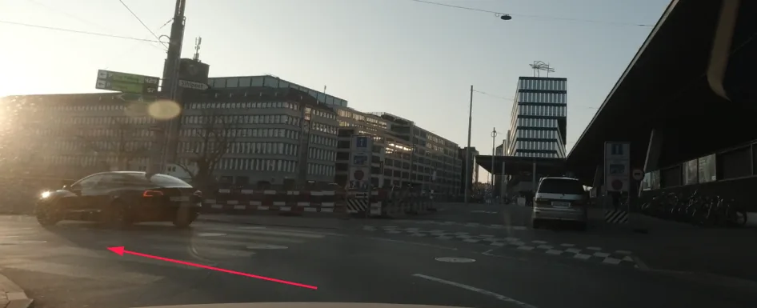

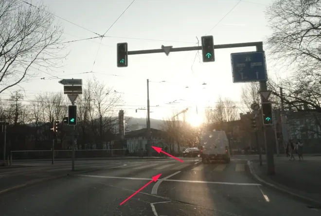

- 这一段保持走左车道会顺畅很多：

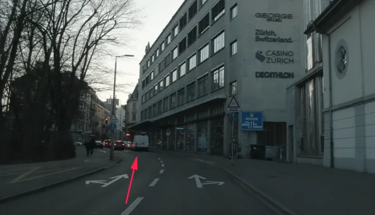

- 注意横向过马路的自行车：

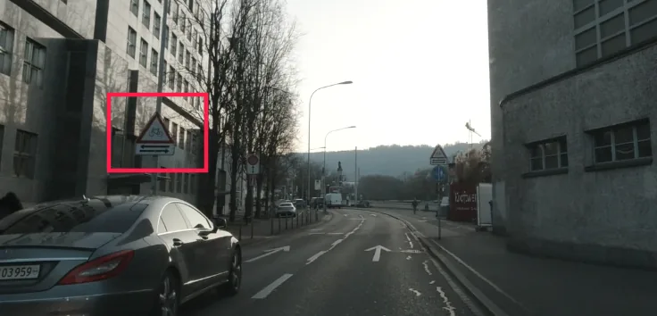

- **右拐提前选道技巧**：这个路口右侧两条车道都可以右拐，所以前面走左/中间车道完全没问题：

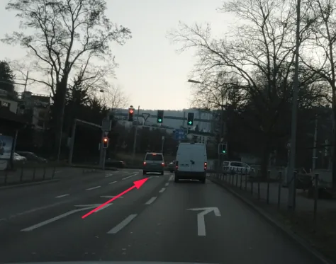

- **而且拐过来以后就会发现最右侧车道并不对**，所以前面提前走左侧/中间车道会省去临时变道的麻烦：

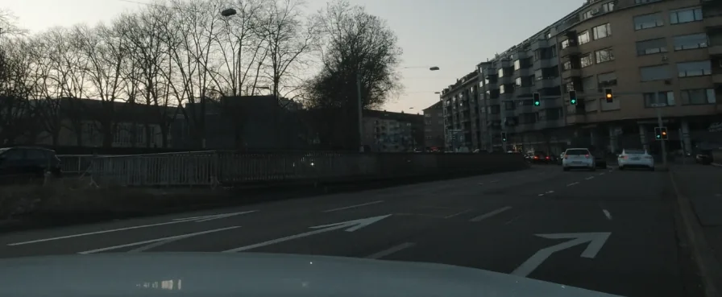

- 随后就可以顺利汇入高速返程了：

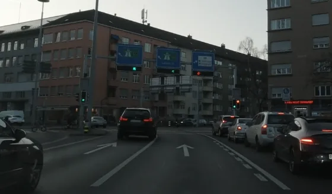
